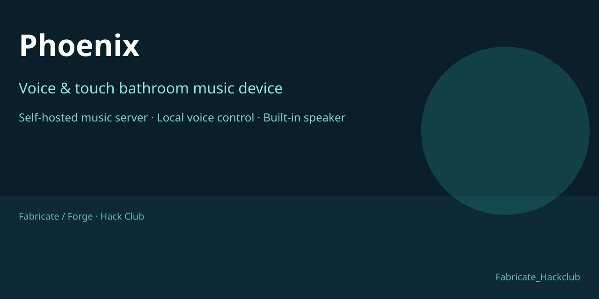
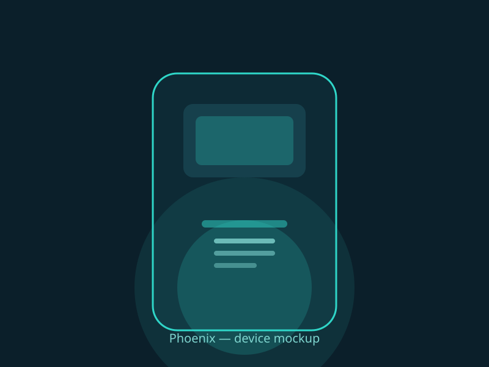
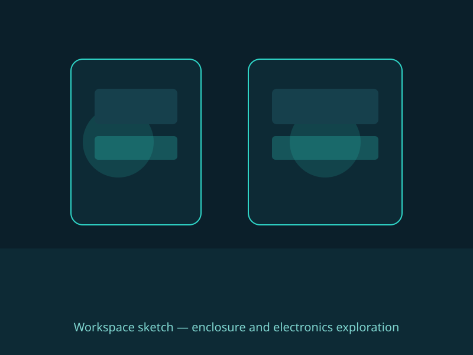

## March 20, 2026: Project kickoff and stack choice

Decided on the core idea: a dedicated bathroom music device that listens for voice requests like "Hey Phoenix, play X by Y" and plays from a self-hosted open source music server, with onboard screen animations instead of a phone.

Chose the software direction first:
- Music server: Airsonic-Advanced as the primary option, with a Subsonic-compatible path in mind in case a lighter server is easier to run locally.
- Voice control: local speech-to-text approach using Vosk for the "play song by name" flow, with a server-side fallback if recognition gets too weak on-device.
- Visuals: small screen with music-reactive or ambient animations rather than a full video player.

One big decision here: this is built around a personal music library, not an all-songs internet catalog. That keeps the project realistic and avoids drifting into a legal/licensing mess.

**Total time spent: 2h**

---

## March 21, 2026: Full design locked, ready for real assembly

Designed the entire device now: product idea, enclosure direction, electronics, software stack, parts direction, and build sequence.

Key decisions:
- Compact Linux device as the core, because it needs to do voice, playback, display, and server access together.
- Built-in speaker and a protected microphone path, because this is a bathroom device, not a bench prototype.
- Small integrated screen for status and visuals, not a phone-style UI.
- Self-hosted music server as the source, with Airsonic-Advanced as the primary choice and Navidrome as the alternative.
- Local-first voice path using a wake-word engine plus Vosk, with simple "play X by Y" intent matching against the library.
- Waterproofing treated as a system: sealed enclosure, acoustic membranes over openings, covered ports, and conformal coating or potting where needed.

Wrote the supporting docs:
- SPEC.md — full design spec
- HARDWARE.md — hardware and build plan
- SOFTWARE.md — software architecture
- PARTS.md — parts and materials direction

Everything is designed except the physical build itself. Left for real-life assembly:
- printing or making the enclosure
- sealing, gasketing, and testing it
- fitting the boards, speaker, mic, and display
- coating/potting and final install
- tuning sound, voice, and enclosure behavior in the actual bathroom

**Total time spent: 3h**

---

## March 22, 2026: Added voice and touch playback controls

Added the full control behavior to the design.

Now the device supports:
- voice commands for play, pause, back, and forward
- touch controls for the same actions
- back/forward with an optional time like "back 10 seconds" or "forward 30"
- a default seek of 15 seconds when no time is given

This makes the device feel like a real music controller instead of just a play/pause box.

Updated the spec and both the hardware and software docs to match:
- touch is now a first-class secondary control
- the screen/touch surface is treated as part of the bathroom-friendly UI
- playback behavior is unified across voice and touch
- seek logic is explicit: use the requested time if provided, otherwise default to 15 seconds

**Total time spent: 2h**

---

## March 23, 2026: Expanded scope for a fuller build

Decided the project should be bigger than a minimal proof of concept. Want the final device to feel complete, not like a rushed demo, so the journal and build need more depth.

Added a feature shortlist to steer the extra work:
- First-run onboarding and setup flow
- Now playing screen with cover art and queue behavior
- Multi-source and fallback music handling
- Context-aware bathroom behavior like idle dimming and brightness tuning
- A stronger feedback layer for wake, command, seek, and error states

The point is not to add random features. The point is to add enough that the project can honestly reach a much larger time total and still feel like one device.

From here, the build split gets bigger:
- more software work for onboarding, queue, fallback, and feedback
- more hardware work for display behavior, lighting, and enclosure tuning
- more integration work for the bathroom environment itself

**Total time spent: 1h**

---

## March 24, 2026: Onboarding and first-run behavior

Started designing what happens when the device is first powered in the bathroom. The device should not assume everything is already configured; it should guide the user through setup and confirmation.

Setup flow ideas:
- detect that it is a first run
- guide the user to connect to the music server
- let the user confirm the wake word
- ask for a quick audio check so mic and speaker levels are reasonable
- show a simple success state when setup looks good

This adds real software work because the device now needs a setup state machine, configuration storage, and a first-run UI path on the screen.

It also adds hardware relevance because audio calibration depends on the actual mic, speaker, and enclosure once those exist.

**Total time spent: 3h**

---

## March 25, 2026: Now playing screen and queue work

Started designing the playback-facing screen so the device can show more than just a status message.

Screen ideas:
- show cover art when available
- show artist and title clearly
- show playback progress
- show what is coming next, at least simply
- keep the UI calm and readable from a distance

This adds a lot of build weight because the screen is no longer only for status messages. It now needs layout, image handling for cover art, progress visualization, and queue state.

It also pushes the software harder because the device has to manage current track, next track, and visual updates together.

**Total time spent: 4h**

---

## March 26, 2026: Multi-source and fallback behavior

Started designing what the device should do when the music server is not reachable or the requested track is not available.

Fallback ideas:
- try the primary server first
- fall back to another local source if the server is down
- keep a small cache or offline path if possible
- show a clear state instead of silently failing

This is a big addition because it changes the device from a single-source player into something more robust for real bathroom use, where Wi-Fi and server availability can be unreliable.

It adds software complexity in error handling, source switching, and status communication.

**Total time spent: 3h**

---

## March 27, 2026: Context-aware bathroom behavior

Started designing behavior that makes the device feel tuned to the bathroom instead of generic.

Behavior ideas:
- dim the screen when idle for a while
- adjust brightness based on surrounding conditions if possible
- stay calm and quiet when nothing is happening
- react differently when the room is noisy versus quiet
- reduce distractions so the device does not feel obnoxious in a small space

This adds both software and hardware relevance. Software needs state tracking and adaptive behavior. Hardware needs display brightness control, and the enclosure and placement start to matter more because the device is being judged in a real environment.

**Total time spent: 3h**

---

## March 28, 2026: Feedback and polish layer

Started designing a stronger feedback system so every action feels deliberate.

Feedback ideas:
- wake confirmation that is noticeable but not annoying
- a short summary when a command is recognized
- seek animation or state change when back/forward happens
- clear error feedback when a request fails
- playback start and stop feedback that is easy to understand at a glance

This is the layer that makes the device feel finished. Without it, the features are there but the device still feels rough. With it, the device starts to feel like a product.

It adds work across the screen, sound cues, interaction timing, and state design.

**Total time spent: 3h**

---

## March 29, 2026: Hardware detail and enclosure refinement

Started expanding the hardware side so the device has more to build than a basic box.

Hardware refinement ideas:
- reconsider speaker position and enclosure volume for better sound
- refine microphone placement for better voice pickup
- plan display recess depth and viewing angle more carefully
- think through cable route, power inlet sealing, and service access
- decide where mounting hardware lives on the body

This is the part of the project that takes real time because the enclosure and mechanical decisions start interacting with the electronics and the bathroom environment. Small changes here can cascade into the sound, the mic, and the waterproofing.

**Total time spent: 4h**

---

## March 30, 2026: Integration, testing, and install planning

Started planning how the device will be tested and installed instead of only designed.

Integration ideas:
- bench test audio, display, touch, and voice together
- test playback and fallback behavior with the server unreachable and reachable
- test the device in a realistic bathroom-like environment
- plan the final mounting location and power route
- plan how the device will be cleaned, maintained, and reopened if needed

This is where the project gets heavier because testing is not just running code. It is checking whether the device actually works as an object in the place it is meant for.

**Total time spent: 3h**

---

## March 31, 2026: Documentation and build-tracking setup

Started building the documentation side so the project has enough record to justify a large total time and stay organized.

Documentation ideas:
- keep the journal updated with real progress notes
- maintain a feature checklist so added work is visible
- track hardware decisions separately from software decisions
- record enclosure, sound, and voice findings as they come up
- keep the repo as the project memory, not just a file drop

This adds time because good documentation is not instant. It forces the project to be described, which makes the later build easier to justify and easier to continue.

**Total time spent: 2h**
