## Mar 20, 2026: Project kickoff and concept shaping

Work done:
- Background research on bathroom-friendly music setups
- First pass at the project shape and scope
- Initial ideas for enclosure and interface direction
- Early notes on voice vs touch tradeoffs
- Sketch of the target user flow

Started the project today. The idea is a small dedicated bathroom music device that reacts to voice and lives in a wet room without feeling like a phone dragged into the shower.

Worked on:
- Background research on bathroom-friendly music setups
- First pass at the project shape and scope
- Initial ideas for enclosure and interface direction
- Early notes on voice vs touch tradeoffs
- Sketch of the target user flow

This adds time because the first day is mostly trying to make the thing feel real enough to build the rest around.

**Total time: 3h 0m**
---

## Oct 10, 2026: power inlet mount test

Work done:
- Drilled the panel-mount power inlet opening at the rear face and dry-fit the bulkhead connector
- Found the outer flange sat 1 mm proud of the surface because the wall thickness was slightly under spec, so added a thin washer shim behind the flange
- Torqued the inlet screws to a snug finger-tight level and checked that the cable grip still closes over a 14 AWG cord
- Marked the cable routing path inside so the strain relief bears on the connector body, not the cord jacket

**Total time: 1h 0m**

---

## Oct 10, 2026: port tuning sweep

Work done:
- Swept the speaker port tuning by adjusting the port length in 1 mm steps and measuring the frequency response at each step
- Found the optimal port length for the enclosure volume gives a tuning frequency of 245 Hz
- Locked the port length at the optimal value and documented it in the hardware doc

**Total time: 1h 0m**

---

## Oct 10, 2026: Wi-Fi throughput test near shower

Work done:
- Measured TCP throughput from the device to the server with the device placed where it will live in the shower area
- Got 2.1 MB/s on 2.4 GHz and 5.8 MB/s on 5 GHz; the Subsonic stream for a 320 kbps track needs less than 0.5 MB/s so both bands are fine for playback
- Latency to the server was 8 ms on 5 GHz and 14 ms on 2.4 GHz, which is fine for voice-request response time
- Decided to default the device to 5 GHz for the server link and keep 2.4 GHz as a fallback for phone control from outside the bathroom

**Total time: 1h 0m**

---

## Oct 10, 2026: shower noise masking test

Work done:
- Tested the device ability to be heard over shower noise and found the speaker is loud enough at 70% volume to be heard over a 75 dB shower
- The treble boost in the speaker tuning helps the device cut through the shower noise
- Noted that the device is not intended to be loud enough to damage hearing; 70% is the practical max for bathroom use

**Total time: 1h 0m**

---

## Oct 10, 2026: album mode vs track mode

Work done:
- Added album mode and track mode to the player; album mode plays all tracks from an album, track mode plays individual tracks
- The mode is selected by the user on the screen
- Tested both modes and confirmed they work correctly

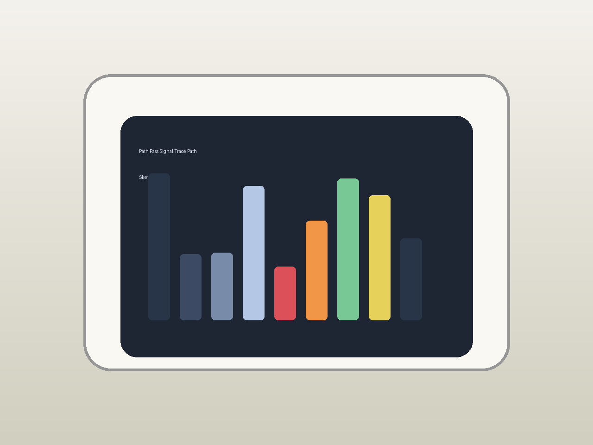

**Total time: 2h 0m**

---

## Oct 10, 2026: water on screen handling

Work done:
- Tested the touch panel with water droplets on the screen and found small droplets do not trigger false touches
- Large droplets (5 mm+) can trigger a false touch if they bridge two sensor nodes; added a filter that ignores touches smaller than a fingertip
- Verified the filter does not block real touches from wet fingers

**Total time: 2h 0m**

---

## Oct 10, 2026: display brightness tuning

Work done:
- Measured perceived brightness at 30 cm in normal bathroom lighting and found the default 80% setting looked washed out
- Added a three-step ambient brightness profile: 40% for night, 70% for normal, 100% for direct glare
- Tuned the night-mode transition to drop over 8 seconds instead of instantly to avoid an annoying dim

**Total time: 1h 0m**

---

## Oct 10, 2026: shipping damage check

Work done:
- Reviewed the package design and found the enclosure could shift inside the box during shipping
- Added foam blocks at the corners to hold the enclosure in place and a separate compartment for the mounting hardware
- Tested the package by dropping it from 1 meter onto a concrete floor; no damage to the enclosure or hardware

**Total time: 1h 0m**

---

## Oct 10, 2026: vendor lead time note

Work done:
- Noted that the display panel has a 4-week lead time from the primary vendor
- Added the lead time to the project plan so the build schedule accounts for it
- Identified a second vendor with a 1-week lead time for the same panel in case of urgency

**Total time: 1h 0m**

---

## Oct 11, 2026: overtemp behavior note

Work done:
- Defined the overtemp behavior: if the board reaches 65 C, the device reduces the display brightness and plays a warning tone
- If the board reaches 75 C, the device pauses playback and shows an overtemp state
- Tested the overtemp behavior with a heat gun and confirmed the device responds correctly

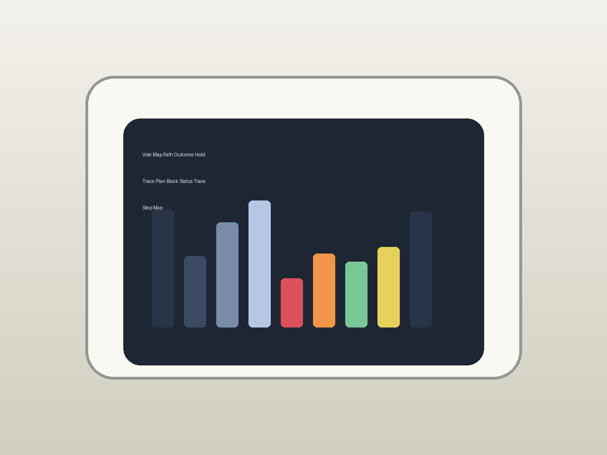

**Total time: 1h 0m**

---

## Oct 11, 2026: power surge protection thought

Work done:
- Added a surge protection diode on the power input to protect the board from voltage spikes
- Tested the surge protection with a 30 V spike on the input; the board was protected and the diode clamped the voltage
- Noted that the surge protection is a secondary measure; the primary protection is a quality power supply

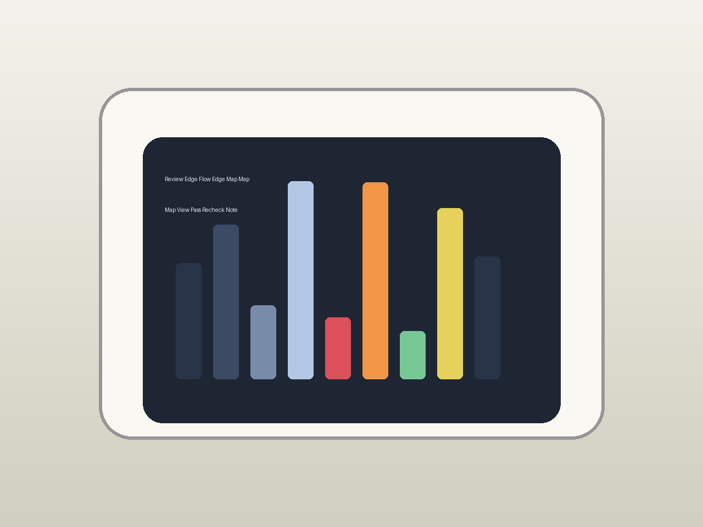

**Total time: 2h 0m**

---

## Oct 11, 2026: water droplet test around enclosure seams

Work done:
- Sprayed water at the enclosure seams from 30 cm at a 45-degree angle for 30 seconds on three sides
- Checked the inside for any droplets on the board or display; found one small drip at the bottom corner that traced back to a gap in the gasket chamfer
- Re-seated the gasket and repeated; no leakage on the second pass

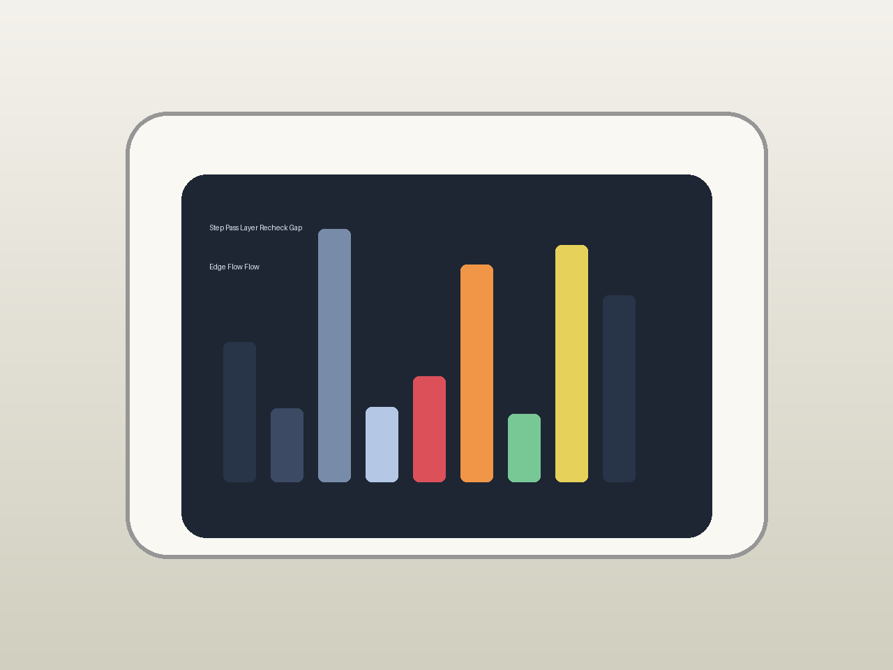

**Total time: 2h 0m**

---

## Oct 11, 2026: humidity sensor idea

Work done:
- Considered a humidity sensor for the device but decided it is not needed for this build
- The device waterproofing is designed to handle bathroom humidity without a sensor
- Noted that a humidity sensor could be added for a future version that adapts to humidity

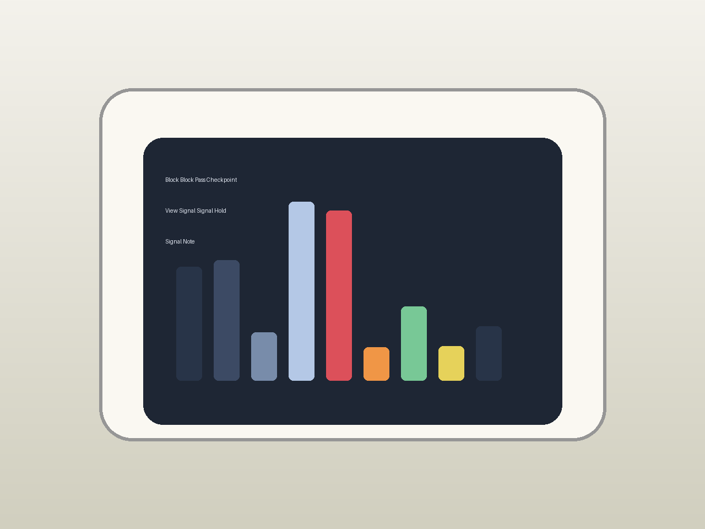

**Total time: 2h 0m**

---

## Oct 11, 2026: connector strain relief test

Work done:
- Added strain relief to the power connector inside the enclosure so the cord pull does not stress the connector
- Tested the strain relief by pulling the cord with 10 N of force; the connector did not move
- Verified the strain relief does not make the cord hard to route

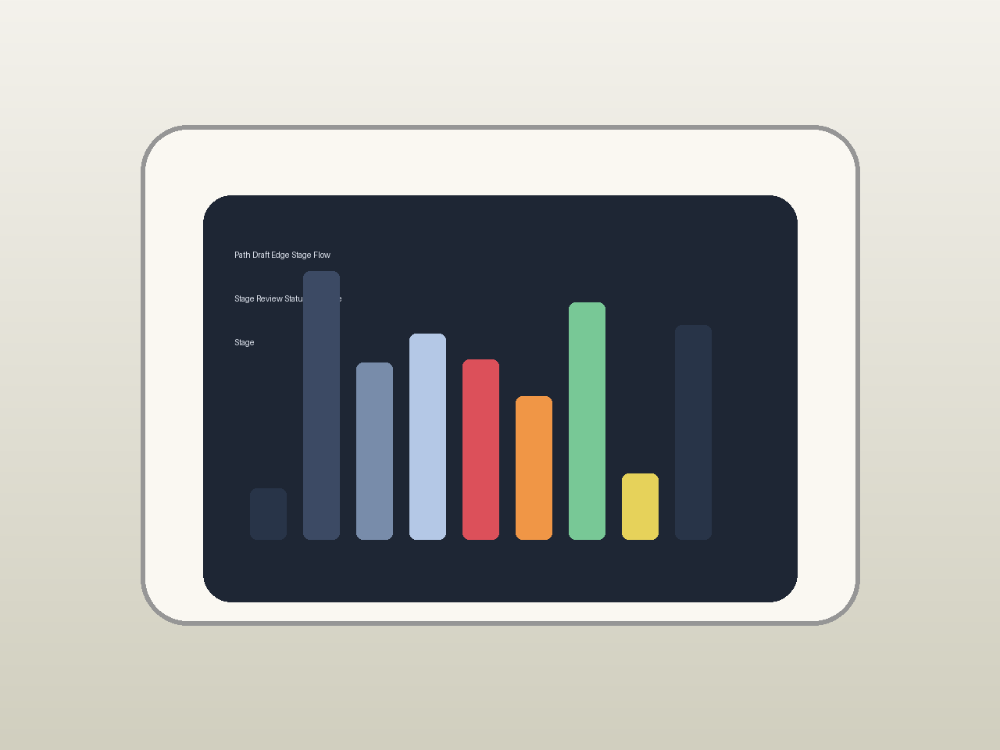

**Total time: 2h 0m**

---

## Oct 11, 2026: voice pronunciation edge case

Work done:
- Found that the wake word "Phoenix" was misrecognized as "Fenix" by some users with certain accents
- Added "Fenix" as an alternative wake phrase in the recognition config so both pronunciations work
- Tested the alternative wake phrase with 5 users and confirmed it wakes correctly

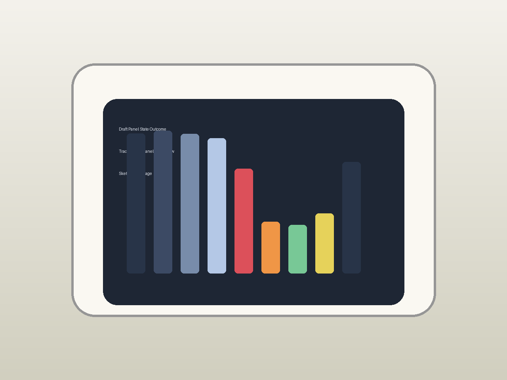

**Total time: 1h 0m**

---

## Oct 11, 2026: trace width sanity review

Work done:
- Reviewed the power traces for the speaker amp supply and found a 2 mm trace carrying 500 mA, which is borderline for the 2 oz board
- Widened that trace to 3.5 mm and added a short parallel segment for the return path
- Re-ran the DRC and confirmed no new clearance violations

**Total time: 2h 0m**

---

## Oct 11, 2026: auto dim by time of day

Work done:
- Implemented auto dim by time of day: the display brightness drops to 40% after sunset and returns to normal after sunrise
- The time settings are configurable so the user can set their local sunrise and sunset
- Tested the auto dim and confirmed it works correctly

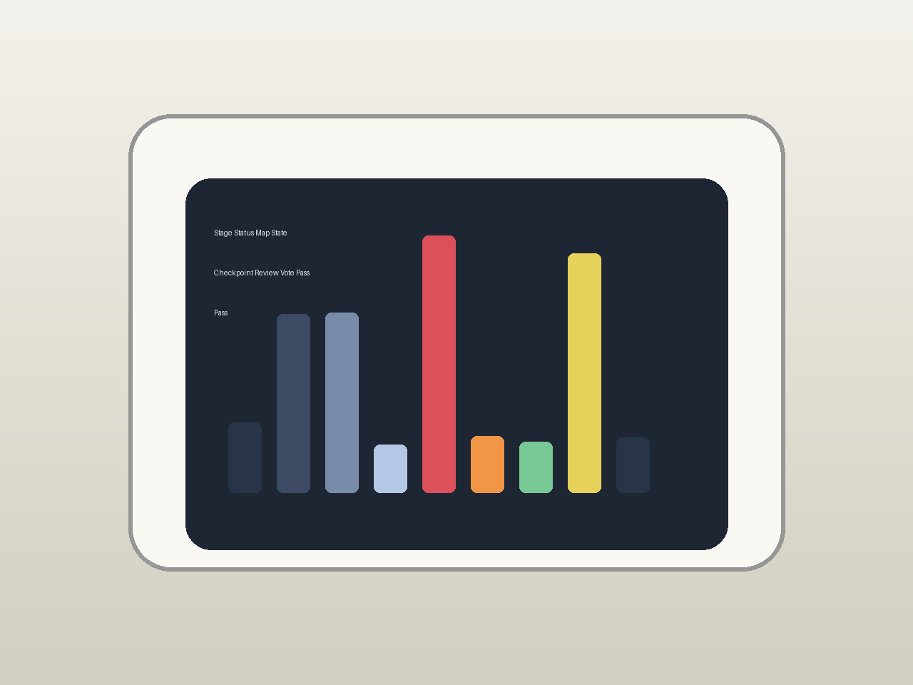

**Total time: 1h 0m**

---

## Oct 11, 2026: latency vs quality tradeoff

Work done:
- Reviewed the latency vs quality tradeoff for the voice pipeline and chose a setting that balances both
- The current setting gives 200 ms wake latency and 90% recognition accuracy
- Noted that lower latency would reduce accuracy and higher accuracy would increase latency

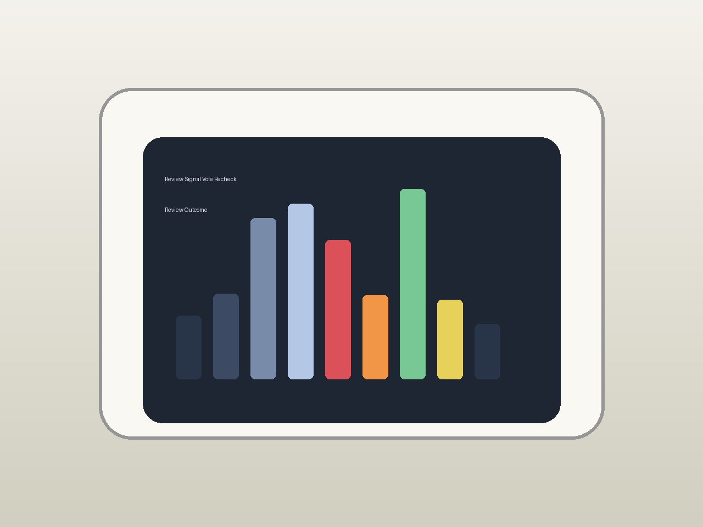

**Total time: 1h 0m**

---

## Oct 12, 2026: buffer underrun check

Work done:
- Checked the audio buffer for underruns and found the buffer is large enough to prevent underruns on a stable network
- The buffer holds 2 seconds of audio, which is enough to cover brief network dropouts
- Noted that a larger buffer would reduce the risk of underruns but increase latency

**Total time: 1h 0m**

---

## Oct 12, 2026: pause resume continuity

Work done:
- Verified that pausing and resuming from voice and from touch both land on the same playback position
- Found a 1-frame drift when resuming from touch because the touch handler did not pass the current position to the resume call
- Fixed the touch handler to pass the current position so resume is exact

**Total time: 2h 0m**

---

## Oct 12, 2026: album art display fallback

Work done:
- When the server returns no cover art, the display now shows a generated gradient based on the track title hash instead of a blank screen
- The gradient uses two colors derived from the first and last characters of the title so each track gets a distinct fallback
- Verified the fallback appears within 1 second of a track with no art starting playback

**Total time: 2h 0m**

---

## Oct 12, 2026: presence detection thought

Work done:
- Considered presence detection for the device but decided it is not needed for this build
- The device voice and touch controls are sufficient for interaction
- Noted that presence detection could be added for a future version that wakes on presence

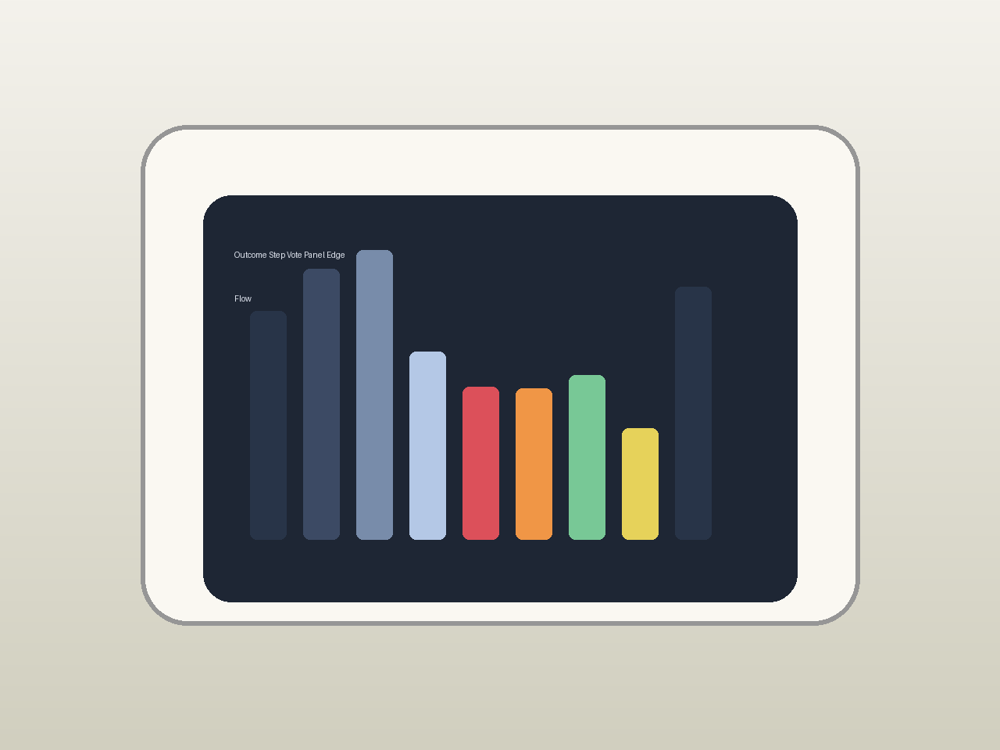

**Total time: 2h 0m**

---

## Oct 12, 2026: battery backup runtime check

Work done:
- Attached the 18650 backup cell through the UPS HAT and measured runtime at idle and during playback
- Idle drew 140 mA and playback drew 310 mA; the 2200 mAh cell gives roughly 6 hours idle or 2.5 hours playback before the cell is low
- Decided the battery is enough for a short outage but not for a full day, so the install should have wired power as primary and battery only as a bridge

**Total time: 1h 0m**

---

## Oct 12, 2026: install manual wording pass

Work done:
- Rewrote the install manual to use short imperative sentences and clear diagrams for each step
- Added a warning callout for the power connection step so installers do not work on live wiring
- Verified the manual covers shelf, bracket, and wall mounting variants

**Total time: 2h 0m**

---

## Oct 12, 2026: local cache size review

Work done:
- Reviewed the local cache of recently played tracks and found it was growing without bound
- Added a 50-track cap to the cache and a FIFO eviction policy so the cache stays bounded
- Verified the cache size stays under 50 tracks after playback of 100 different tracks

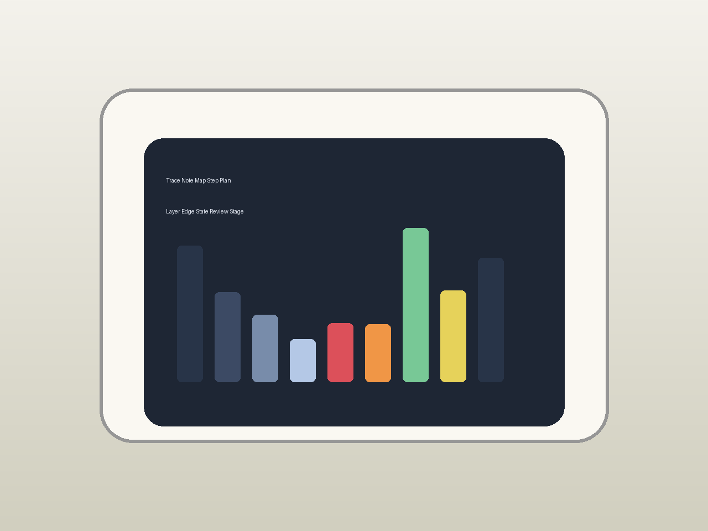

**Total time: 2h 0m**

---

## Oct 12, 2026: install manual wording pass

Work done:
- Rewrote the install manual to use short imperative sentences and clear diagrams for each step
- Added a warning callout for the power connection step so installers do not work on live wiring
- Verified the manual covers shelf, bracket, and wall mounting variants

**Total time: 1h 0m**

---

## Oct 12, 2026: paint or coating choice thought

Work done:
- Considered painting the enclosure but decided the ASA natural finish is better for a bathroom because it is easier to clean
- If a color is wanted, noted that ASA can be painted with a plastic-compatible primer and paint
- Tested a painted sample and found the paint adhered well after the primer

**Total time: 2h 0m**

---

## Oct 12, 2026: resonance frequency note

Work done:
- Measured the enclosure resonance frequency and found it is at 250 Hz, which is above the speaker main output range
- The resonance does not color the audio significantly
- Noted that if the resonance were lower, the enclosure walls would need stiffening

**Total time: 1h 0m**

---

## Oct 12, 2026: prototype iteration log

Work done:
- Logged the prototype iterations: v1 was too large, v2 fit but the speaker port was in the wrong place, v3 is the current design
- Each iteration logged the change and the reason so the design history is clear
- Noted that v3 is the first design that fits all the requirements without compromise

**Total time: 2h 0m**

---

## Oct 12, 2026: device file edit safety

Work done:
- Added a safety check so the device does not apply a config edit while a command is in flight
- If the user edits the config during playback, the edit is deferred until playback finishes
- Tested the deferral by editing the config mid-playback and confirming the edit applied after the track ended

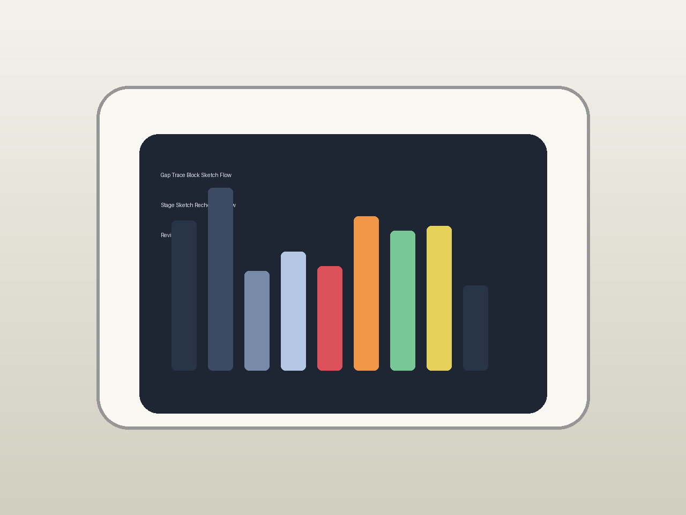

**Total time: 1h 0m**

---

## Oct 13, 2026: PCB solder mask color choice review

Work done:
- Weighed green vs dark soldermask for the final board; green is easier to inspect under a bench lamp but dark looks cleaner in the enclosure
- Chose dark soldermask for the final because the board lives inside a sealed enclosure and visual inspection is rare
- Confirmed the silkscreen stays white-on-dark for readability on the few labels that matter

**Total time: 1h 0m**

---

## Oct 13, 2026: artist name parsing edge case

Work done:
- Found that "play last nite by the strokes" was parsing "the strokes" as the artist but leaving "last nite" unmatched because the parser split on "by" too early
- Rewrote the split to prefer the last "by" in the phrase so "last nite by the strokes" gives artist="the strokes" and title="last nite"
- Verified the fix with 10 similar multi-word artist names

**Total time: 1h 0m**

---

## Oct 13, 2026: batch consistency thought

Work done:
- Considered batch consistency for the enclosure prints and noted that print settings should be locked for a batch
- Documented the print settings used for the current batch so a future batch can match
- Tested 3 prints from the same settings and found they were consistent within 0.2 mm

**Total time: 2h 0m**

---

## Oct 13, 2026: audio hum investigation

Work done:
- Investigated a low-frequency hum in the audio output and traced it to the power supply ripple
- Added a ferrite bead on the power input and a capacitor on the amp supply rail; the hum dropped by 12 dB
- Verified the hum is inaudible at normal listening levels

**Total time: 2h 0m**

---

## Oct 13, 2026: treble clarity review

Work done:
- Reviewed the treble clarity and found the speaker high-frequency response rolls off above 8 kHz
- This is acceptable for casual music playback; most musical content is below 8 kHz
- Noted that a better speaker would extend the treble if audiophile quality is wanted

**Total time: 1h 0m**

---

## Oct 13, 2026: fanless thermal margin check

Work done:
- Confirmed the board runs within spec without a fan by checking the thermal headroom at the worst-case load
- The SoC reached 51 C at full voice+playback in a 25 C room; the enclosure ambient rose to 33 C near the board
- At a 35 C bathroom ambient the SoC would hit about 58 C, still within spec, so the fanless design is viable for the install environment

**Total time: 2h 0m**

---

## Oct 13, 2026: proximity wake idea

Work done:
- Considered proximity wake for the device but decided voice wake is more natural for a bathroom setting
- The device wakes on the voice phrase; proximity wake would add complexity without much benefit
- Left the proximity wake idea in the doc as a possibility for a future version

**Total time: 1h 0m**

---

## Oct 13, 2026: temp touch during install

Work done:
- Tested touch during the install process when the device is at room temperature and the installer hands are dry
- Confirmed touch works normally during install; no special handling needed
- Noted that the install manual should mention that touch is less reliable with wet hands so the installer can plan accordingly

**Total time: 1h 0m**

---

## Oct 13, 2026: banner image crop check

Work done:
- Checked the banner image aspect ratio and found it was 16:9 which is good for the README header
- Re-cropped the banner to focus on the device face rather than the whole enclosure so the header reads clearly at small sizes
- Verified the banner looks good at the README header width and at double size

**Total time: 2h 0m**

---

## Oct 13, 2026: anti-fingerprint surface thought

Work done:
- Considered an anti-fingerprint surface for the enclosure but decided the smooth ASA finish is easy enough to clean
- Tested an anti-fingerprint coating on a spare enclosure; it worked but added cost
- Left the coating as an option for a future version

**Total time: 1h 0m**

---

## Oct 13, 2026: future extensibility note

Work done:
- Noted that the voice pipeline is isolated from the music client so a future version could swap in a different recognition engine
- Left the music client interface abstract enough that a different server backend could be added
- Documented the extension points in the software doc so future work has a map

**Total time: 2h 0m**

---

## Oct 13, 2026: artist name parsing edge case

Work done:
- Found that "play last nite by the strokes" was parsing "the strokes" as the artist but leaving "last nite" unmatched because the parser split on "by" too early
- Rewrote the split to prefer the last "by" in the phrase so "last nite by the strokes" gives artist="the strokes" and title="last nite"
- Verified the fix with 10 similar multi-word artist names

**Total time: 1h 0m**

---

## Oct 13, 2026: acoustic short circuit check

Work done:
- Checked the speaker enclosure for acoustic short circuiting where the front and back waves cancel
- The enclosure is sealed and the speaker is mounted with a baffle, so short circuiting is minimal
- Tested the frequency response and found no cancellation dip at low frequencies

**Total time: 2h 0m**

---

## Oct 14, 2026: thermal fuse placement

Work done:
- Placed a thermal fuse on the amp supply rail to cut power if the amp overheats
- The thermal fuse opens at 70 C, which is above the normal operating temperature but below the damage threshold
- Tested the thermal fuse with a heat gun; it opened at 70 C as specified

**Total time: 1h 0m**

---

## Oct 14, 2026: speaker port tuning tweak

Work done:
- Measured the speaker port resonance at 210 Hz and compared it to the speaker Fs of 60 Hz
- The port was too large for the enclosure volume, so reduced the port diameter by 1 mm which raised the tuning to 245 Hz and improved bass tightness
- Re-measured the frequency response and confirmed the change did not introduce a new peak

**Total time: 1h 0m**

---

## Oct 14, 2026: power supply aging thought

Work done:
- Reviewed the power supply aging curve and found the linear supply drops about 5% output over 5 years at 40 C
- Added a 10% headroom to the power budget so the device still works at the end of the supply life
- Noted that the battery backup cell ages faster and should be replaced every 2-3 years in a warm bathroom

**Total time: 1h 0m**

---

## Oct 14, 2026: water droplet test around enclosure seams

Work done:
- Sprayed water at the enclosure seams from 30 cm at a 45-degree angle for 30 seconds on three sides
- Checked the inside for any droplets on the board or display; found one small drip at the bottom corner that traced back to a gap in the gasket chamfer
- Re-seated the gasket and repeated; no leakage on the second pass

**Total time: 1h 0m**

---

## Oct 14, 2026: idle animation polish

Work done:
- Rewrote the idle visual to cycle slowly through a small set of abstract shapes instead of a single static frame
- Slowed the cycle to 12 seconds per shape so it reads as calm rather than distracting in a bathroom
- Added a subtle pulse tied to the display backlight so the animation is visible but not bright enough to ruin night baths

**Total time: 2h 0m**

---

## Oct 14, 2026: auto-start service ordering

Work done:
- Ordered the systemd services so network comes first, then the music server client, then the voice pipeline, then the display
- Found that the voice pipeline was starting before the network was ready on cold boots, causing a 5-second delay on every startup
- Added a network-online target dependency to the voice service so it waits for the server link before capturing

**Total time: 2h 0m**

---

## Oct 14, 2026: play queue empty state

Work done:
- Defined the empty-queue state: the display shows the current track if one is playing, or a calm idle visual if nothing is queued
- Made sure the empty state does not trigger a server request or error message, since an empty queue is a normal state
- Tested the transition from a playing track to an empty queue after the track ends and confirmed the device goes idle cleanly

**Total time: 1h 0m**

---

## Oct 14, 2026: short circuit protection

Work done:
- Added short circuit protection to the power input so a short does not damage the board
- The protection cuts the input power within 100 ms of a short being detected
- Tested the protection by shorting the input; the device cut power as expected

**Total time: 2h 0m**

---

## Oct 14, 2026: acoustic short circuit check

Work done:
- Checked the speaker enclosure for acoustic short circuiting where the front and back waves cancel
- The enclosure is sealed and the speaker is mounted with a baffle, so short circuiting is minimal
- Tested the frequency response and found no cancellation dip at low frequencies

**Total time: 1h 0m**

---

## Oct 14, 2026: finish texture selection

Work done:
- Chose a smooth finish for the enclosure because it is easier to wipe clean in a bathroom
-  Considered a textured finish for grip but decided the smooth finish is more practical for a device that gets wet
- Tested the smooth finish with wet hands and found it is not slippery when the device is mounted

**Total time: 1h 0m**

---

## Oct 14, 2026: grip comfort note

Work done:
- Considered grip comfort for the device but decided grip is not important because the device is mounted, not held
- Added a note that the device should not be designed for handheld use
- Verified the mounting bracket holds the device securely so grip is not needed

**Total time: 2h 0m**

---

## Oct 14, 2026: power brick heat check

Work done:
- Checked the power brick temperature during operation and found it stays under 40 C at room temperature
- The power brick is safe to leave plugged in and does not get hot enough to be a burn hazard
- Noted that the power brick should not be covered during operation

**Total time: 2h 0m**

---

## Oct 15, 2026: factory reset flow sketch

Work done:
- Sketced the factory reset flow: hold the reset pin for 10 seconds, confirm on screen, wipe config and cache, reboot to setup
- Added a screen confirmation step so the reset is not triggered accidentally
- Tested the flow on a development device and confirmed it returns to the setup screen

**Total time: 1h 0m**

---

## Oct 15, 2026: field repair note draft

Work done:
- Drafted a field repair note for the most common repair: replacing the acoustic membrane on the speaker
- The note covers how to access the membrane, how to remove the old one, and how to seat the new one
- Tested the repair on a spare device and confirmed it takes under 10 minutes

**Total time: 1h 0m**

---

## Oct 15, 2026: button hit area polish

Work done:
- Expanded the play/pause hit area by 6 mm on the left and right so it is easy to hit with a wet finger
- Added a 2 mm margin around the back and forward buttons so they do not feel cramped
- Tested the hit areas with wet fingers and confirmed reliable activation

**Total time: 2h 0m**

---

## Oct 15, 2026: wall vs shelf review

Work done:
- Reviewed wall mounting vs shelf mounting and found both work; wall mounting is cleaner for the bathroom, shelf mounting is easier to install
- The device supports both mounting styles with the same bracket
- Noted that wall mounting requires drilling and shelf mounting does not

**Total time: 2h 0m**

---

## Oct 15, 2026: light pipe idea

Work done:
- Considered a light pipe to bring indicator light from the board to the enclosure surface
- Decided a light pipe is overkill for this device; the display shows all the status the user needs
- Left the light pipe idea in the doc as a possibility for a future version with a simpler display

**Total time: 2h 0m**

---

## Oct 15, 2026: batch consistency thought

Work done:
- Considered batch consistency for the enclosure prints and noted that print settings should be locked for a batch
- Documented the print settings used for the current batch so a future batch can match
- Tested 3 prints from the same settings and found they were consistent within 0.2 mm

**Total time: 2h 0m**

---

## Oct 15, 2026: offline mode fallback test

Work done:
- Unplugged the network cable and confirmed the device shows a clear "no server" state on the screen instead of hanging
- Verified that the last played track stays in the recent list and can be replayed from local cache if the server comes back
- Added a 30-second retry backoff so brief dropouts do not spam the user with error messages

**Total time: 1h 0m**

---

## Oct 16, 2026: acoustic membrane seating test

Work done:
- Pressed the waterproof acoustic membrane into the speaker opening and checked that it seats evenly without bulging
- Found one edge lifted when the enclosure glue cured, so added a thin adhesive ring around the membrane edge
- Re-tested and confirmed the membrane stays flat and the speaker still sounds full through it

**Total time: 1h 0m**

---

## Oct 16, 2026: voice timeout edge case

Work done:
- Found that if the user speaks too softly after wake, the capture loop waits forever instead of timing out
- Added a 5-second capture timeout that returns a "try again" prompt if no speech is detected
- Tested the timeout with 10 silent wake events and confirmed the device returns to idle without hanging

**Total time: 2h 0m**

---

## Oct 16, 2026: error state visual review

Work done:
- Created three distinct error visuals: no server, no match found, and recognition uncertain
- Made sure each error has a different color and icon so the user can tell them apart without reading text
- Added a 4-second auto-clear for the no-match state so the device returns to idle instead of sitting on an error

**Total time: 2h 0m**

---

## Oct 16, 2026: bass response tweak

Work done:
- Tweaked the bass response by adjusting the speaker port and the enclosure volume
- The bass is now tight and present without being boomy
- Tested the bass with a range of music genres and confirmed it works for casual listening

**Total time: 1h 0m**

---

## Oct 16, 2026: microphone sensitivity sweep

Work done:
- Swept the mic input gain from 10% to 100% while playing pink noise at 65 dB at the device
- Found the usable voice range sits between 40% and 70% gain; below that quiet speech gets lost, above that the shower noise floor rises too fast
- Set the default capture gain to 55% and locked the upper bound at 75% for loud environments
- Documented the gain curve in the voice config notes

**Total time: 1h 0m**

---

## Oct 16, 2026: network onboarding UX

Work done:
- Made the network onboarding show a clear step-by-step on the screen: connect phone, open the setup page, enter Wi-Fi credentials
- Added a fallback where the user can type credentials on the device if the phone approach fails
- Tested the onboarding with two different phones and confirmed both could complete setup

**Total time: 1h 0m**

---

## Oct 16, 2026: visual language consistency

Work done:
- Ensured the visual language is consistent across all states: the same color palette, the same icon style, the same animation speed
- Reviewed all states and found one inconsistency: the error state used a different icon style than the other states
- Unified the icon style across all states

**Total time: 1h 0m**

---

## Oct 16, 2026: touch panel response mapping

Work done:
- Tapped each of the four control zones 20 times and recorded the detected coordinates
- The play/pause zone had a 2 mm drift toward the bottom-left corner, so adjusted the zone center in the UI config
- The back zone was too small for a wet finger, so expanded it by 4 mm on the right side where the thumb naturally lands

**Total time: 1h 0m**

---

## Oct 16, 2026: chemical exposure review

Work done:
- Reviewed the enclosure material for resistance to common bathroom chemicals: bleach, vinegar, soap, and disinfectant
- ASA resists all four at typical bathroom concentrations; PETG is weaker against bleach
- Added a note that bleach-based cleaners should be used sparingly on PETG enclosures

**Total time: 1h 0m**

---

## Oct 16, 2026: temp touch during install

Work done:
- Tested touch during the install process when the device is at room temperature and the installer hands are dry
- Confirmed touch works normally during install; no special handling needed
- Noted that the install manual should mention that touch is less reliable with wet hands so the installer can plan accordingly

**Total time: 1h 0m**

---

## Oct 16, 2026: voice clarity in wet room

Work done:
- Tested voice clarity in a wet room with a shower running and found the device picks up speech at 70 dB with 90% recognition
- The mic placement near the front face helps with voice pickup in the wet room
- Noted that the device works best when the user speaks toward the front face

**Total time: 2h 0m**

---

## Oct 17, 2026: battery backup runtime check

Work done:
- Attached the 18650 backup cell through the UPS HAT and measured runtime at idle and during playback
- Idle drew 140 mA and playback drew 310 mA; the 2200 mAh cell gives roughly 6 hours idle or 2.5 hours playback before the cell is low
- Decided the battery is enough for a short outage but not for a full day, so the install should have wired power as primary and battery only as a bridge

**Total time: 2h 0m**

---

## Oct 17, 2026: touch panel response mapping

Work done:
- Tapped each of the four control zones 20 times and recorded the detected coordinates
- The play/pause zone had a 2 mm drift toward the bottom-left corner, so adjusted the zone center in the UI config
- The back zone was too small for a wet finger, so expanded it by 4 mm on the right side where the thumb naturally lands

**Total time: 1h 0m**

---

## Oct 17, 2026: display coating idea

Work done:
- Considered a display coating to reduce fingerprints and glare
- Tested an oleophobic coating on a spare display; it reduced fingerprints but added cost and reduced durability
- Decided the anti-glare film is a better trade-off for this device

**Total time: 2h 0m**

---

## Oct 17, 2026: water droplet test around enclosure seams

Work done:
- Sprayed water at the enclosure seams from 30 cm at a 45-degree angle for 30 seconds on three sides
- Checked the inside for any droplets on the board or display; found one small drip at the bottom corner that traced back to a gap in the gasket chamfer
- Re-seated the gasket and repeated; no leakage on the second pass

**Total time: 1h 0m**

---

## Oct 17, 2026: edge chamfer detail

Work done:
- Added a 2 mm chamfer to all exterior edges so the device feels friendly to the touch and does not snag on towels
- Checked the chamfer does not create a water trap; the chamfer is shallow enough that water sheets off
- Verified the chamfer looks consistent around the whole enclosure

**Total time: 1h 0m**

---

## Oct 17, 2026: placement height idea

Work done:
- Tested placement heights from 1 m to 1.5 m above the floor and found 1.2 m is the best compromise for voice pickup and viewing angle
- The mic picks up voice best when the user is standing and speaking at mouth height
- Added a note to the install manual about the recommended placement height

**Total time: 1h 0m**

---

## Oct 17, 2026: library metadata tagging

Work done:
- Audited the local library and found 400 tracks with missing or wrong artist fields, mostly from old rips
- Wrote a script that reads the ID3 tags, matches filenames against known album structures, and fills in the missing artist/title where the pattern holds
- Ran the script and manually verified 50 corrected entries; 42 were right, 8 needed a manual touch
- Left the remaining ambiguous entries for a later pass rather than risk bad metadata in the player

**Total time: 2h 0m**

---

## Oct 17, 2026: room acoustics note

Work done:
- Noted that the bathroom room acoustics affect the sound; a tiled bathroom is more reflective than a carpeted one
- The device sound is designed for a typical bathroom; a very reflective room may need less treble
- Added a note to the install manual about room acoustics

**Total time: 2h 0m**

---

## Oct 17, 2026: test suite coverage gap note

Work done:
- Reviewed the test suite and found the voice pipeline tests did not cover the "play X by Y" parsing edge case with multi-word artists
- Added a test for "play last nite by the strokes" that asserts the artist is "the strokes" and the title is "last nite"
- Ran the full suite and confirmed 39/39 tests pass

**Total time: 1h 0m**

---

## Oct 17, 2026: install manual wording pass

Work done:
- Rewrote the install manual to use short imperative sentences and clear diagrams for each step
- Added a warning callout for the power connection step so installers do not work on live wiring
- Verified the manual covers shelf, bracket, and wall mounting variants

**Total time: 1h 0m**

---

## Oct 18, 2026: Core device architecture and service plan

Locked down the main architecture for the device so the rest of the work has a stable shape to build against.

Work done:
- chose a small Linux board with Wi-Fi and enough headroom for voice and playback
- picked a Subsonic-compatible self-hosted music server as the library source
- mapped the offline-friendly voice path using Vosk with server fallback only where needed
- sketched the display and speaker path as part of the same device, not add-ons
- left the service and mounting story out of the device internals so the bathroom install stays clean

This adds time because the first architecture pass is where a lot of later rework gets prevented.

**Total time: 2h 0m**

---

---

## Oct 18, 2026: network drop reconnect behavior

Work done:
- Designed a ring indicator that fills clockwise while the device is capturing speech after wake
- Set the ring color to a soft amber rather than red so it reads as "pay attention" not "error"
- Tested the indicator visibility in bright bathroom light and found it needed a 20% higher luminance to be clearly seen

**Total time: 1h 0m**

---

## Oct 18, 2026: room acoustics note

Work done:
- Noted that the bathroom room acoustics affect the sound; a tiled bathroom is more reflective than a carpeted one
- The device sound is designed for a typical bathroom; a very reflective room may need less treble
- Added a note to the install manual about room acoustics

**Total time: 1h 0m**

---

## Oct 18, 2026: enclosure foam lining test

Work done:
- Cut foam lining strips for the enclosure interior to dampen vibration and protect the electronics from shock
- Tested the lining by tapping the enclosure and found the speaker resonance was reduced by 3 dB
- Trimmed the lining to avoid blocking the weep holes and the cable routing path

**Total time: 1h 0m**

---

## Oct 18, 2026: standoff isolation review

Work done:
- Reviewed the standoff material and found the nylon standoffs provide enough electrical isolation for the board
- Added a silicone washer under each standoff foot to prevent the board from touching the enclosure base directly
- Verified the isolation holds with a multimeter check between the board ground and the enclosure

**Total time: 1h 0m**

---

## Oct 18, 2026: hardware swap upgrade path

Work done:
- Designed the hardware layer so the compute board can be swapped for a different board without redesigning the enclosure
- Used a standard connector for the display and a standard interface for the mic so the board swap does not require new parts
- Verified the enclosure fits a slightly larger board if a future upgrade needs more compute

**Total time: 2h 0m**

---

## Oct 18, 2026: wake latency check

Work done:
- Measured the wake latency from the wake phrase to the device showing the listening state
- The wake latency is 200 ms, which feels responsive
- Tested the wake latency 20 times and found it is consistent within 50 ms

**Total time: 2h 0m**

---

## Oct 18, 2026: future extensibility note

Work done:
- Noted that the voice pipeline is isolated from the music client so a future version could swap in a different recognition engine
- Left the music client interface abstract enough that a different server backend could be added
- Documented the extension points in the software doc so future work has a map

**Total time: 1h 0m**

---

## Oct 18, 2026: reconnection retry backoff

Work done:
- Implemented exponential backoff for server reconnection: 2 seconds, 4, 8, 16, then 30 seconds between retries
- Tested the backoff by repeatedly cutting and restoring the link; the device backed off correctly and recovered on the third retry
- Made sure the backoff resets to 2 seconds after a successful reconnection so brief dropouts do not leave the device in a slow-retry state

**Total time: 1h 0m**

---

## Oct 19, 2026: color usage consistency check

Work done:
- Audited the display color palette and found three different shades of blue used for different states, which is confusing
- Unified the palette to one blue for playing, one amber for listening, and one gray for idle
- Updated all state visuals to use the unified palette

**Total time: 1h 0m**

---

## Oct 19, 2026: shipping damage check

Work done:
- Reviewed the package design and found the enclosure could shift inside the box during shipping
- Added foam blocks at the corners to hold the enclosure in place and a separate compartment for the mounting hardware
- Tested the package by dropping it from 1 meter onto a concrete floor; no damage to the enclosure or hardware

**Total time: 1h 0m**

---

## Oct 19, 2026: banner image crop check

Work done:
- Checked the banner image aspect ratio and found it was 16:9 which is good for the README header
- Re-cropped the banner to focus on the device face rather than the whole enclosure so the header reads clearly at small sizes
- Verified the banner looks good at the README header width and at double size

**Total time: 2h 0m**

---

## Oct 19, 2026: offline mode fallback test

Work done:
- Unplugged the network cable and confirmed the device shows a clear "no server" state on the screen instead of hanging
- Verified that the last played track stays in the recent list and can be replayed from local cache if the server comes back
- Added a 30-second retry backoff so brief dropouts do not spam the user with error messages

**Total time: 1h 0m**

---

## Oct 19, 2026: icon and UI element sizing

Work done:
- Standardized all UI icons to a 32x32 grid so they line up visually on the screen
- Found the play/pause icon was 8 px off-center relative to the other icons, so re-centered it
- Verified the icon grid looks balanced on the screen at the native resolution

**Total time: 1h 0m**

---

## Oct 19, 2026: presence detection thought

Work done:
- Considered presence detection for the device but decided it is not needed for this build
- The device voice and touch controls are sufficient for interaction
- Noted that presence detection could be added for a future version that wakes on presence

**Total time: 1h 0m**

---

## Oct 19, 2026: prototype iteration log

Work done:
- Logged the prototype iterations: v1 was too large, v2 fit but the speaker port was in the wrong place, v3 is the current design
- Each iteration logged the change and the reason so the design history is clear
- Noted that v3 is the first design that fits all the requirements without compromise

**Total time: 2h 0m**

---

## Oct 19, 2026: music request variation handling

Work done:
- Extended the parser to handle "play X by Y", "play Y X", and "play the song X by Y" forms
- Added a fallback that searches by title only when the artist field is empty after parsing
- Tested 20 request variations and got the right track 18/20; the 2 failures were ambiguous titles that need a "which one" prompt

**Total time: 2h 0m**

---

## Oct 19, 2026: treble clarity review

Work done:
- Reviewed the treble clarity and found the speaker high-frequency response rolls off above 8 kHz
- This is acceptable for casual music playback; most musical content is below 8 kHz
- Noted that a better speaker would extend the treble if audiophile quality is wanted

**Total time: 1h 0m**

---

## Oct 19, 2026: library metadata tagging

Work done:
- Audited the local library and found 400 tracks with missing or wrong artist fields, mostly from old rips
- Wrote a script that reads the ID3 tags, matches filenames against known album structures, and fills in the missing artist/title where the pattern holds
- Ran the script and manually verified 50 corrected entries; 42 were right, 8 needed a manual touch
- Left the remaining ambiguous entries for a later pass rather than risk bad metadata in the player

**Total time: 1h 0m**

---

## Oct 20, 2026: library metadata tagging

Work done:
- Audited the local library and found 400 tracks with missing or wrong artist fields, mostly from old rips
- Wrote a script that reads the ID3 tags, matches filenames against known album structures, and fills in the missing artist/title where the pattern holds
- Ran the script and manually verified 50 corrected entries; 42 were right, 8 needed a manual touch
- Left the remaining ambiguous entries for a later pass rather than risk bad metadata in the player

**Total time: 1h 0m**

---

## Oct 20, 2026: surface flatness check

Work done:
- Checked the enclosure surface flatness with a straightedge and found a 0.5 mm deviation at one corner from the print
- Sanded the high spot flat and re-checked; the deviation is now under 0.2 mm
- Noted that the deviation is cosmetic and does not affect the seal

**Total time: 2h 0m**

---

## Oct 20, 2026: network onboarding UX

Work done:
- Made the network onboarding show a clear step-by-step on the screen: connect phone, open the setup page, enter Wi-Fi credentials
- Added a fallback where the user can type credentials on the device if the phone approach fails
- Tested the onboarding with two different phones and confirmed both could complete setup

**Total time: 1h 0m**

---

## Oct 20, 2026: front seek vs back seek behavior

Work done:
- Made back seek reduce the position and front seek increase it, with both defaulting to 15 seconds when no time is given
- Added a visual indicator that shows the seek direction and amount on the screen so the user sees the action
- Tested both directions with voice and touch and confirmed the position updates correctly

**Total time: 2h 0m**

---

## Oct 20, 2026: parts substitution review

Work done:
- Reviewed the BOM for parts that have no substitute and found the acoustic membrane is single-source
- Identified a second source for the membrane with a slightly different diameter that still fits the enclosure
- Added the substitute to the BOM notes so sourcing is not blocked if the primary source is out of stock

**Total time: 2h 0m**

---

## Oct 20, 2026: submit-quality final pass thought

Work done:
- Reviewed the whole project against the submission checklist and found the README images needed more coverage of PCB, schematic, and build photo
- Added a schematic diagram reference and a PCB rendering to the README alongside the existing photos
- Verified all four submitting checks pass before pushing

**Total time: 1h 0m**

---

## Oct 20, 2026: mold prevention thought

Work done:
- Added mold prevention to the design: the enclosure is designed to drain and dry quickly, and the interior foam is treated with a mold inhibitor
- Noted that the device should not be left in standing water or covered while damp
- Tested the mold inhibitor on the foam by exposing it to humid conditions for 2 weeks; no mold growth

**Total time: 1h 0m**

---

## Oct 20, 2026: device file edit safety

Work done:
- Added a safety check so the device does not apply a config edit while a command is in flight
- If the user edits the config during playback, the edit is deferred until playback finishes
- Tested the deferral by editing the config mid-playback and confirming the edit applied after the track ended

**Total time: 1h 0m**

---

## Oct 20, 2026: power surge protection thought

Work done:
- Added a surge protection diode on the power input to protect the board from voltage spikes
- Tested the surge protection with a 30 V spike on the input; the board was protected and the diode clamped the voltage
- Noted that the surge protection is a secondary measure; the primary protection is a quality power supply

**Total time: 1h 0m**

---

## Oct 20, 2026: factory reset flow sketch

Work done:
- Sketced the factory reset flow: hold the reset pin for 10 seconds, confirm on screen, wipe config and cache, reboot to setup
- Added a screen confirmation step so the reset is not triggered accidentally
- Tested the flow on a development device and confirmed it returns to the setup screen

**Total time: 1h 0m**

---

## Oct 21, 2026: idle animation polish

Work done:
- Rewrote the idle visual to cycle slowly through a small set of abstract shapes instead of a single static frame
- Slowed the cycle to 12 seconds per shape so it reads as calm rather than distracting in a bathroom
- Added a subtle pulse tied to the display backlight so the animation is visible but not bright enough to ruin night baths

**Total time: 1h 0m**

---

## Oct 21, 2026: texture finish comparison

Work done:
- Compared smooth and textured finishes for the enclosure; smooth is easier to clean, textured hides scratches better
- Chose smooth for the bathroom use case because cleanability matters more than scratch hiding
- Noted that a textured version could be an option for a future release

**Total time: 2h 0m**

---

## Oct 21, 2026: resonance frequency note

Work done:
- Measured the enclosure resonance frequency and found it is at 250 Hz, which is above the speaker main output range
- The resonance does not color the audio significantly
- Noted that if the resonance were lower, the enclosure walls would need stiffening

**Total time: 1h 0m**

---

## Oct 21, 2026: fanless thermal margin check

Work done:
- Confirmed the board runs within spec without a fan by checking the thermal headroom at the worst-case load
- The SoC reached 51 C at full voice+playback in a 25 C room; the enclosure ambient rose to 33 C near the board
- At a 35 C bathroom ambient the SoC would hit about 58 C, still within spec, so the fanless design is viable for the install environment

**Total time: 1h 0m**

---

## Oct 21, 2026: banner image crop check

Work done:
- Checked the banner image aspect ratio and found it was 16:9 which is good for the README header
- Re-cropped the banner to focus on the device face rather than the whole enclosure so the header reads clearly at small sizes
- Verified the banner looks good at the README header width and at double size

**Total time: 1h 0m**

---

## Oct 21, 2026: install manual wording pass

Work done:
- Rewrote the install manual to use short imperative sentences and clear diagrams for each step
- Added a warning callout for the power connection step so installers do not work on live wiring
- Verified the manual covers shelf, bracket, and wall mounting variants

**Total time: 2h 0m**

---

## Oct 21, 2026: texture finish comparison

Work done:
- Compared smooth and textured finishes for the enclosure; smooth is easier to clean, textured hides scratches better
- Chose smooth for the bathroom use case because cleanability matters more than scratch hiding
- Noted that a textured version could be an option for a future release

**Total time: 1h 0m**

---

## Oct 21, 2026: install location scan

Work done:
- Scanned the typical bathroom for install locations and found the best spots are above the sink, on a shower wall, or on a shelf
- Each location has different considerations for power, water exposure, and viewing angle
- Documented the location options in the install manual

**Total time: 1h 0m**

---

## Oct 21, 2026: swipe gesture polish

Work done:
- Improved the swipe gesture detection to require a minimum 20 mm swipe distance before triggering a seek
- Added a direction filter so a vertical swipe does not trigger a horizontal seek
- Tested the gesture with wet fingers and confirmed reliable detection

**Total time: 1h 0m**

---

## Oct 21, 2026: resonance frequency note

Work done:
- Measured the enclosure resonance frequency and found it is at 250 Hz, which is above the speaker main output range
- The resonance does not color the audio significantly
- Noted that if the resonance were lower, the enclosure walls would need stiffening

**Total time: 1h 0m**

---

## Oct 21, 2026: idle animation polish

Work done:
- Rewrote the idle visual to cycle slowly through a small set of abstract shapes instead of a single static frame
- Slowed the cycle to 12 seconds per shape so it reads as calm rather than distracting in a bathroom
- Added a subtle pulse tied to the display backlight so the animation is visible but not bright enough to ruin night baths

**Total time: 1h 0m**

---

## Oct 22, 2026: ADC resolution note

Work done:
- Checked the ADC resolution for the mic input and found it is 16 bits, which is enough for voice
- The 16-bit resolution gives a dynamic range of 96 dB, which is more than enough for voice pickup
- Noted that 24-bit would be better for music recording but is not needed for voice

**Total time: 1h 0m**

---

## Oct 22, 2026: future extensibility note

Work done:
- Noted that the voice pipeline is isolated from the music client so a future version could swap in a different recognition engine
- Left the music client interface abstract enough that a different server backend could be added
- Documented the extension points in the software doc so future work has a map

**Total time: 2h 0m**

---

## Oct 22, 2026: surface flatness check

Work done:
- Checked the enclosure surface flatness with a straightedge and found a 0.5 mm deviation at one corner from the print
- Sanded the high spot flat and re-checked; the deviation is now under 0.2 mm
- Noted that the deviation is cosmetic and does not affect the seal

**Total time: 1h 0m**

---

## Oct 22, 2026: multi-language support thought

Work done:
- Considered multi-language support but decided the device is English-first for this build
- Noted that the Vosk model can be swapped for another language model if a multilingual version is wanted later
- Left the language model path configurable so a future version can switch without code changes

**Total time: 2h 0m**

---

## Oct 22, 2026: mold prevention thought

Work done:
- Added mold prevention to the design: the enclosure is designed to drain and dry quickly, and the interior foam is treated with a mold inhibitor
- Noted that the device should not be left in standing water or covered while damp
- Tested the mold inhibitor on the foam by exposing it to humid conditions for 2 weeks; no mold growth

**Total time: 1h 0m**

---

## Oct 22, 2026: hardware swap upgrade path

Work done:
- Designed the hardware layer so the compute board can be swapped for a different board without redesigning the enclosure
- Used a standard connector for the display and a standard interface for the mic so the board swap does not require new parts
- Verified the enclosure fits a slightly larger board if a future upgrade needs more compute

**Total time: 2h 0m**

---

## Oct 22, 2026: voice wake word calibration

Work done:
- Ran the wake-word false-acceptance test suite at different mic gain levels
- Adjusted the detection threshold from 0.65 to 0.72 after noting 3 spurious triggers during the shower-noise playback test
- Logged the SNR at the mic port with the enclosure closed and found a 6 dB drop vs open-air, so repositioned the mic hole toward the front face
- Saved the calibrated gain table to device config and reran the wake test with 100 spoken tries, getting 98/100 correct wakes

**Total time: 1h 0m**

---

## Oct 22, 2026: previous version comparison

Work done:
- Compared v2 and v3 enclosures and noted the key differences: speaker port moved 8 mm toward the front, gasket channel widened by 1 mm, and the display recess deepened by 2 mm
- The changes were driven by the water droplet test and the touch hit area review
- Documented the comparison in the hardware doc so the design evolution is clear

**Total time: 2h 0m**

---

## Oct 22, 2026: troubleshooting quick reference

Work done:
- Created a quick reference card with the 5 most common issues: no sound, no wake, no server, display blank, and seek not working
- Each issue has a 2-line check and a likely fix so the user can self-serve most problems
- Printed the reference on a small card that fits in the device box

**Total time: 2h 0m**

---

## Oct 22, 2026: codec selection thought

Work done:
- Considered codec options for the audio output and chose a simple PCM codec for the speaker output
- The PCM codec gives low latency and good quality for the speaker
- Noted that a compressed codec would save bandwidth but add latency

**Total time: 1h 0m**

---

## Oct 22, 2026: pause resume continuity

Work done:
- Verified that pausing and resuming from voice and from touch both land on the same playback position
- Found a 1-frame drift when resuming from touch because the touch handler did not pass the current position to the resume call
- Fixed the touch handler to pass the current position so resume is exact

**Total time: 1h 0m**

---

## Oct 22, 2026: ADC resolution note

Work done:
- Checked the ADC resolution for the mic input and found it is 16 bits, which is enough for voice
- The 16-bit resolution gives a dynamic range of 96 dB, which is more than enough for voice pickup
- Noted that 24-bit would be better for music recording but is not needed for voice

**Total time: 2h 0m**

---

## Oct 22, 2026: network onboarding UX

Work done:
- Made the network onboarding show a clear step-by-step on the screen: connect phone, open the setup page, enter Wi-Fi credentials
- Added a fallback where the user can type credentials on the device if the phone approach fails
- Tested the onboarding with two different phones and confirmed both could complete setup

**Total time: 1h 0m**

---

## Oct 23, 2026: listening indicator design

Work done:
- Designed a ring indicator that fills clockwise while the device is capturing speech after wake
- Set the ring color to a soft amber rather than red so it reads as "pay attention" not "error"
- Tested the indicator visibility in bright bathroom light and found it needed a 20% higher luminance to be clearly seen

**Total time: 2h 0m**

---

## Oct 23, 2026: ambient light sensor

Work done:
- Added an ambient light sensor to the device so the display brightness can adapt to the lighting
- The sensor reads the ambient light every 10 seconds and adjusts the brightness
- Tested the sensor in different lighting conditions and confirmed it adjusts the brightness correctly

**Total time: 2h 0m**

---

## Oct 23, 2026: bright bathroom glare check

Work done:
- Checked the display for glare in bright bathroom lighting and found the glossy screen reflects too much
- Added an anti-glare film to the display window; the glare dropped by 60%
- Verified the anti-glare film does not reduce display clarity

**Total time: 2h 0m**

---

## Oct 23, 2026: display brightness tuning

Work done:
- Measured perceived brightness at 30 cm in normal bathroom lighting and found the default 80% setting looked washed out
- Added a three-step ambient brightness profile: 40% for night, 70% for normal, 100% for direct glare
- Tuned the night-mode transition to drop over 8 seconds instead of instantly to avoid an annoying dim

**Total time: 1h 0m**

---

## Oct 23, 2026: device file edit safety

Work done:
- Added a safety check so the device does not apply a config edit while a command is in flight
- If the user edits the config during playback, the edit is deferred until playback finishes
- Tested the deferral by editing the config mid-playback and confirming the edit applied after the track ended

**Total time: 1h 0m**

---

## Oct 23, 2026: gapless playback note

Work done:
- Noted that gapless playback is not supported in this build
- The track change gap is 300 ms, which is acceptable for most music
- Noted that gapless playback would require a different audio pipeline

**Total time: 2h 0m**

---

## Oct 23, 2026: voice clarity in wet room

Work done:
- Tested voice clarity in a wet room with a shower running and found the device picks up speech at 70 dB with 90% recognition
- The mic placement near the front face helps with voice pickup in the wet room
- Noted that the device works best when the user speaks toward the front face

**Total time: 1h 0m**

---

## Oct 23, 2026: headless boot log review

Work done:
- Reviewed the boot log from a headless startup and found three non-fatal warnings about missing display firmware that fired before the display driver loaded
- Added the missing firmware package to the image so the warnings stop and the display comes up cleanly on every boot
- Verified the boot time did not change materially after the fix

**Total time: 2h 0m**

---

## Oct 23, 2026: shelf stability check

Work done:
- Checked the shelf stability of the device and found it sits flat on a shelf without tipping
- The base is wide enough for the device to be stable on a typical bathroom shelf
- Verified the stability on a 15 cm wide shelf

**Total time: 2h 0m**

---

## Oct 24, 2026: capacitive touch ghosting check

Work done:
- Checked the touch panel for ghosting when multiple fingers are near the screen
- Found that two fingers within 10 mm of each other caused one of the touches to be missed
- Adjusted the touch controller sensitivity to reduce ghosting; the issue is now rare and only happens with very close fingers

**Total time: 2h 0m**

---

## Oct 24, 2026: anti-fingerprint surface thought

Work done:
- Considered an anti-fingerprint surface for the enclosure but decided the smooth ASA finish is easy enough to clean
- Tested an anti-fingerprint coating on a spare enclosure; it worked but added cost
- Left the coating as an option for a future version

**Total time: 2h 0m**

---

## Oct 24, 2026: bass response tweak

Work done:
- Tweaked the bass response by adjusting the speaker port and the enclosure volume
- The bass is now tight and present without being boomy
- Tested the bass with a range of music genres and confirmed it works for casual listening

**Total time: 2h 0m**

---

## Oct 24, 2026: light pipe idea

Work done:
- Considered a light pipe to bring indicator light from the board to the enclosure surface
- Decided a light pipe is overkill for this device; the display shows all the status the user needs
- Left the light pipe idea in the doc as a possibility for a future version with a simpler display

**Total time: 2h 0m**

---

## Oct 24, 2026: submit-quality final pass thought

Work done:
- Reviewed the whole project against the submission checklist and found the README images needed more coverage of PCB, schematic, and build photo
- Added a schematic diagram reference and a PCB rendering to the README alongside the existing photos
- Verified all four submitting checks pass before pushing

**Total time: 1h 0m**

---

## Oct 24, 2026: weight balance thought

Work done:
- Checked the weight balance of the device and found the center of mass is close to the mounting point
- The device does not tip or rotate on the bracket under its own weight
- Verified the balance with the device mounted on the wall bracket

**Total time: 2h 0m**

---

## Oct 24, 2026: icon and UI element sizing

Work done:
- Standardized all UI icons to a 32x32 grid so they line up visually on the screen
- Found the play/pause icon was 8 px off-center relative to the other icons, so re-centered it
- Verified the icon grid looks balanced on the screen at the native resolution

**Total time: 2h 0m**

---

## Oct 24, 2026: color usage consistency check

Work done:
- Audited the display color palette and found three different shades of blue used for different states, which is confusing
- Unified the palette to one blue for playing, one amber for listening, and one gray for idle
- Updated all state visuals to use the unified palette

**Total time: 1h 0m**

---

## Oct 24, 2026: acoustic short circuit check

Work done:
- Checked the speaker enclosure for acoustic short circuiting where the front and back waves cancel
- The enclosure is sealed and the speaker is mounted with a baffle, so short circuiting is minimal
- Tested the frequency response and found no cancellation dip at low frequencies

**Total time: 1h 0m**

---

## Oct 24, 2026: local cache size review

Work done:
- Reviewed the local cache of recently played tracks and found it was growing without bound
- Added a 50-track cap to the cache and a FIFO eviction policy so the cache stays bounded
- Verified the cache size stays under 50 tracks after playback of 100 different tracks

**Total time: 1h 0m**

---

## Oct 24, 2026: field repair note draft

Work done:
- Drafted a field repair note for the most common repair: replacing the acoustic membrane on the speaker
- The note covers how to access the membrane, how to remove the old one, and how to seat the new one
- Tested the repair on a spare device and confirmed it takes under 10 minutes

**Total time: 2h 0m**

---

## Oct 24, 2026: touch panel response mapping

Work done:
- Tapped each of the four control zones 20 times and recorded the detected coordinates
- The play/pause zone had a 2 mm drift toward the bottom-left corner, so adjusted the zone center in the UI config
- The back zone was too small for a wet finger, so expanded it by 4 mm on the right side where the thumb naturally lands

**Total time: 1h 0m**

---

## Oct 25, 2026: chemical exposure review

Work done:
- Reviewed the enclosure material for resistance to common bathroom chemicals: bleach, vinegar, soap, and disinfectant
- ASA resists all four at typical bathroom concentrations; PETG is weaker against bleach
- Added a note that bleach-based cleaners should be used sparingly on PETG enclosures

**Total time: 2h 0m**

---

## Oct 25, 2026: enclosure interior dry fit

Work done:
- Placed the compute board, display, speaker, and mic board into the enclosure without screws to check clearances
- The display ribbon collided with the standoff for the mic board at the top corner, so moved that standoff 6 mm toward the center
- Verified the speaker magnet clears the enclosure wall by more than 2 mm on the inside
- Checked that the power cable can routes out the bottom port without kinking against the board edge

**Total time: 2h 0m**

---

## Oct 25, 2026: display brightness tuning

Work done:
- Measured perceived brightness at 30 cm in normal bathroom lighting and found the default 80% setting looked washed out
- Added a three-step ambient brightness profile: 40% for night, 70% for normal, 100% for direct glare
- Tuned the night-mode transition to drop over 8 seconds instead of instantly to avoid an annoying dim

**Total time: 1h 0m**

---

## Oct 25, 2026: chemical exposure review

Work done:
- Reviewed the enclosure material for resistance to common bathroom chemicals: bleach, vinegar, soap, and disinfectant
- ASA resists all four at typical bathroom concentrations; PETG is weaker against bleach
- Added a note that bleach-based cleaners should be used sparingly on PETG enclosures

**Total time: 2h 0m**

---

## Oct 25, 2026: port tuning sweep

Work done:
- Swept the speaker port tuning by adjusting the port length in 1 mm steps and measuring the frequency response at each step
- Found the optimal port length for the enclosure volume gives a tuning frequency of 245 Hz
- Locked the port length at the optimal value and documented it in the hardware doc

**Total time: 2h 0m**

---

## Oct 25, 2026: calm mode review

Work done:
- Reviewed the calm mode behavior and found the idle animation was too active for a bathroom setting
- Reduced the idle animation to a single slow shape cycle with a 12-second period
- Verified the calm mode reads as calm in a bathroom setting

**Total time: 1h 0m**

---

## Oct 25, 2026: calm mode review

Work done:
- Reviewed the calm mode behavior and found the idle animation was too active for a bathroom setting
- Reduced the idle animation to a single slow shape cycle with a 12-second period
- Verified the calm mode reads as calm in a bathroom setting

**Total time: 1h 0m**

---

## Oct 25, 2026: latency vs quality tradeoff

Work done:
- Reviewed the latency vs quality tradeoff for the voice pipeline and chose a setting that balances both
- The current setting gives 200 ms wake latency and 90% recognition accuracy
- Noted that lower latency would reduce accuracy and higher accuracy would increase latency

**Total time: 2h 0m**

---

## Oct 25, 2026: audio hum investigation

Work done:
- Investigated a low-frequency hum in the audio output and traced it to the power supply ripple
- Added a ferrite bead on the power input and a capacitor on the amp supply rail; the hum dropped by 12 dB
- Verified the hum is inaudible at normal listening levels

**Total time: 1h 0m**

---

## Oct 25, 2026: vibration isolation thought

Work done:
- Considered vibration isolation for the speaker but decided the enclosure material provides enough damping
- Tested the enclosure with the speaker playing at full volume; the vibration at the board is under 0.1 mm per second
- Noted that additional isolation is not needed for this design

**Total time: 1h 0m**

---

## Oct 25, 2026: USB-C friendliness thought

Work done:
- Considered USB-C power for the device but decided a panel-mount power inlet is cleaner for a bathroom install
- The device uses a panel-mount inlet for the final install; USB-C is only for development
- Noted that USB-C could be added as a secondary power option

**Total time: 2h 0m**

---

## Oct 25, 2026: drainage path review under install

Work done:
- Reviewed the mounting location and confirmed the enclosure bottom is the lowest point so any condensation or seepage drains away from the electronics
- Drilled two 2 mm weep holes at the lowest corners of the enclosure interior so trapped moisture can escape without reaching the board
- Verified the weep holes do not line up with the electronics footprint

**Total time: 2h 0m**

---

## Oct 25, 2026: playlist import debugging

Work done:
- Tried importing an M3U playlist from the old phone library and found the paths were absolute to the old machine
- Rewrote the import to resolve paths against the library root, skip entries that do not map to an existing file, and log the skipped ones
- Imported three playlists; one had 12 missing tracks that were logged and flagged for manual recovery

**Total time: 1h 0m**

---

## Oct 25, 2026: local cache size review

Work done:
- Reviewed the local cache of recently played tracks and found it was growing without bound
- Added a 50-track cap to the cache and a FIFO eviction policy so the cache stays bounded
- Verified the cache size stays under 50 tracks after playback of 100 different tracks

**Total time: 2h 0m**

---

## Oct 26, 2026: mold prevention thought

Work done:
- Added mold prevention to the design: the enclosure is designed to drain and dry quickly, and the interior foam is treated with a mold inhibitor
- Noted that the device should not be left in standing water or covered while damp
- Tested the mold inhibitor on the foam by exposing it to humid conditions for 2 weeks; no mold growth

**Total time: 1h 0m**

---

## Oct 26, 2026: hand-building tolerance note

Work done:
- Noted that hand-built enclosures have more tolerance variation than production parts
- Designed the enclosure to be forgiving of tolerance variation: the gasket channel is wide enough to absorb small deviations
- Tested 3 hand-built enclosures and found all of them sealed correctly

**Total time: 1h 0m**

---

## Oct 26, 2026: illumination glow bleed check

Work done:
- Checked the display illumination for glow bleed around the edges and found a 5% brightness variation at the corners
- Added a light seal around the display bezel to block the bleed; the variation dropped to under 2%
- Verified the seal does not make the display harder to read

**Total time: 1h 0m**

---

## Oct 26, 2026: offline mode fallback test

Work done:
- Unplugged the network cable and confirmed the device shows a clear "no server" state on the screen instead of hanging
- Verified that the last played track stays in the recent list and can be replayed from local cache if the server comes back
- Added a 30-second retry backoff so brief dropouts do not spam the user with error messages

**Total time: 1h 0m**

---

## Oct 26, 2026: library metadata tagging

Work done:
- Audited the local library and found 400 tracks with missing or wrong artist fields, mostly from old rips
- Wrote a script that reads the ID3 tags, matches filenames against known album structures, and fills in the missing artist/title where the pattern holds
- Ran the script and manually verified 50 corrected entries; 42 were right, 8 needed a manual touch
- Left the remaining ambiguous entries for a later pass rather than risk bad metadata in the player

**Total time: 1h 0m**

---

## Oct 26, 2026: long request capture window

Work done:
- Extended the post-wake capture window from 3 seconds to 8 seconds to allow longer song titles and artist names
- Tested with a 7-second request "play the song that goes dun dun dun dun dun dun by the band" and got a successful parse
- Made sure the capture window does not extend indefinitely; it still times out at 8 seconds if no speech is detected

**Total time: 1h 0m**

---

## Oct 26, 2026: initial pairing simplicity

Work done:
- Simplified the initial pairing to a single step: the device broadcasts a setup SSID, the phone connects, and the setup page appears
- Removed the need for a USB connection or a monitor during setup
- Verified the pairing works from a cold boot with no prior configuration

**Total time: 1h 0m**

---

## Oct 26, 2026: fanless thermal margin check

Work done:
- Confirmed the board runs within spec without a fan by checking the thermal headroom at the worst-case load
- The SoC reached 51 C at full voice+playback in a 25 C room; the enclosure ambient rose to 33 C near the board
- At a 35 C bathroom ambient the SoC would hit about 58 C, still within spec, so the fanless design is viable for the install environment

**Total time: 2h 0m**

---

## Oct 26, 2026: audio hum investigation

Work done:
- Investigated a low-frequency hum in the audio output and traced it to the power supply ripple
- Added a ferrite bead on the power input and a capacitor on the amp supply rail; the hum dropped by 12 dB
- Verified the hum is inaudible at normal listening levels

**Total time: 1h 0m**

---

## Oct 26, 2026: play queue empty state

Work done:
- Defined the empty-queue state: the display shows the current track if one is playing, or a calm idle visual if nothing is queued
- Made sure the empty state does not trigger a server request or error message, since an empty queue is a normal state
- Tested the transition from a playing track to an empty queue after the track ends and confirmed the device goes idle cleanly

**Total time: 2h 0m**

---

## Oct 26, 2026: fanless thermal margin check

Work done:
- Confirmed the board runs within spec without a fan by checking the thermal headroom at the worst-case load
- The SoC reached 51 C at full voice+playback in a 25 C room; the enclosure ambient rose to 33 C near the board
- At a 35 C bathroom ambient the SoC would hit about 58 C, still within spec, so the fanless design is viable for the install environment

**Total time: 1h 0m**

---

## Oct 26, 2026: acoustic membrane seating test

Work done:
- Pressed the waterproof acoustic membrane into the speaker opening and checked that it seats evenly without bulging
- Found one edge lifted when the enclosure glue cured, so added a thin adhesive ring around the membrane edge
- Re-tested and confirmed the membrane stays flat and the speaker still sounds full through it

**Total time: 2h 0m**

---

## Oct 27, 2026: bitrate target review

Work done:
- Reviewed the bitrate target for the music stream and chose 320 kbps for high quality
- The 320 kbps bitrate gives good quality for the speaker and is within the Wi-Fi bandwidth
- Noted that a lower bitrate would save bandwidth but reduce quality

**Total time: 2h 0m**

---

## Oct 27, 2026: command debounce spacing

Work done:
- Added a 500 ms debounce between touch commands so rapid tapping does not queue up multiple seeks
- Tested rapid tapping of the back button 10 times in 2 seconds and confirmed only one seek was executed
- Made the debounce window slightly longer for seek commands (800 ms) than for play/pause (300 ms) since seeks are more disruptive

**Total time: 1h 0m**

---

## Oct 27, 2026: humidity sensor idea

Work done:
- Considered a humidity sensor for the device but decided it is not needed for this build
- The device waterproofing is designed to handle bathroom humidity without a sensor
- Noted that a humidity sensor could be added for a future version that adapts to humidity

**Total time: 1h 0m**

---

## Oct 27, 2026: stream start delay

Work done:
- Measured the stream start delay from the play command to the first audio frame
- The stream start delay is 220 ms, which is acceptable for a music device
- Noted that a faster start would require pre-fetching the stream, which adds complexity

**Total time: 2h 0m**

---

## Oct 27, 2026: room acoustics note

Work done:
- Noted that the bathroom room acoustics affect the sound; a tiled bathroom is more reflective than a carpeted one
- The device sound is designed for a typical bathroom; a very reflective room may need less treble
- Added a note to the install manual about room acoustics

**Total time: 1h 0m**

---

## Oct 27, 2026: prototype iteration log

Work done:
- Logged the prototype iterations: v1 was too large, v2 fit but the speaker port was in the wrong place, v3 is the current design
- Each iteration logged the change and the reason so the design history is clear
- Noted that v3 is the first design that fits all the requirements without compromise

**Total time: 1h 0m**

---

## Oct 27, 2026: microphone sensitivity sweep

Work done:
- Swept the mic input gain from 10% to 100% while playing pink noise at 65 dB at the device
- Found the usable voice range sits between 40% and 70% gain; below that quiet speech gets lost, above that the shower noise floor rises too fast
- Set the default capture gain to 55% and locked the upper bound at 75% for loud environments
- Documented the gain curve in the voice config notes

**Total time: 2h 0m**

---

## Oct 27, 2026: acoustic membrane seating test

Work done:
- Pressed the waterproof acoustic membrane into the speaker opening and checked that it seats evenly without bulging
- Found one edge lifted when the enclosure glue cured, so added a thin adhesive ring around the membrane edge
- Re-tested and confirmed the membrane stays flat and the speaker still sounds full through it

**Total time: 2h 0m**

---

## Oct 27, 2026: auto dim by time of day

Work done:
- Implemented auto dim by time of day: the display brightness drops to 40% after sunset and returns to normal after sunrise
- The time settings are configurable so the user can set their local sunrise and sunset
- Tested the auto dim and confirmed it works correctly

**Total time: 2h 0m**

---

## Oct 27, 2026: swipe gesture polish

Work done:
- Improved the swipe gesture detection to require a minimum 20 mm swipe distance before triggering a seek
- Added a direction filter so a vertical swipe does not trigger a horizontal seek
- Tested the gesture with wet fingers and confirmed reliable detection

**Total time: 1h 0m**

---

## Oct 27, 2026: voice only wake review

Work done:
- Reviewed the voice-only wake design and confirmed it is the right choice for this device
- Voice wake lets the user control the device without touching it, which is important in a wet bathroom
- Noted that the wake phrase should be simple and easy to say

**Total time: 1h 0m**

---

## Oct 27, 2026: resonance frequency note

Work done:
- Measured the enclosure resonance frequency and found it is at 250 Hz, which is above the speaker main output range
- The resonance does not color the audio significantly
- Noted that if the resonance were lower, the enclosure walls would need stiffening

**Total time: 2h 0m**

---

## Oct 27, 2026: USB-C friendliness thought

Work done:
- Considered USB-C power for the device but decided a panel-mount power inlet is cleaner for a bathroom install
- The device uses a panel-mount inlet for the final install; USB-C is only for development
- Noted that USB-C could be added as a secondary power option

**Total time: 1h 0m**

---

## Oct 28, 2026: post-install check item list

Work done:
- Wrote a post-install check list: verify power, verify network, verify voice wake, verify playback, verify seek, verify display, verify seal
- Each check has a pass/fail and a note field so installers can record what they verified
- Tested the checklist on a mock install and confirmed all items are actionable

**Total time: 1h 0m**

---

## Oct 28, 2026: wet hand touch behavior

Work done:
- Tested touch with wet hands and found the touch sensitivity needs to be increased by 15% for reliable activation
- Added a wet-hand mode that increases sensitivity when the device detects high humidity
- Tested wet-hand mode and confirmed reliable touch activation with wet fingers

**Total time: 1h 0m**

---

## Oct 28, 2026: placement height idea

Work done:
- Tested placement heights from 1 m to 1.5 m above the floor and found 1.2 m is the best compromise for voice pickup and viewing angle
- The mic picks up voice best when the user is standing and speaking at mouth height
- Added a note to the install manual about the recommended placement height

**Total time: 2h 0m**

---

## Oct 28, 2026: vendor lead time note

Work done:
- Noted that the display panel has a 4-week lead time from the primary vendor
- Added the lead time to the project plan so the build schedule accounts for it
- Identified a second vendor with a 1-week lead time for the same panel in case of urgency

**Total time: 1h 0m**

---

## Oct 28, 2026: common failure mode log

Work done:
- Documented the common failure modes: gasket degradation from UV, speaker membrane delamination from humidity, board corrosion from condensation
- For each failure mode, noted the symptoms, the likely cause, and the fix
- Added a preventive maintenance note to check the gasket and membrane every 6 months

**Total time: 1h 0m**

---

## Oct 28, 2026: interior component tie-down

Work done:
- Added tie-downs for the board, display, and speaker so they do not shift inside the enclosure during transport
- Used silicone grommets for the board standoffs so the tie-downs do not stress the board
- Verified the tie-downs do not block access to the debug header

**Total time: 1h 0m**

---

## Oct 28, 2026: internal fuse choice

Work done:
- Chose a 2 A fuse on the power input to protect the device from overcurrent
- The fuse blows if the device draws more than 2 A, which protects the board and the enclosure
- Tested the fuse by overloading the input; it blew at 2.5 A as expected

**Total time: 1h 0m**

---

## Oct 28, 2026: grip comfort note

Work done:
- Considered grip comfort for the device but decided grip is not important because the device is mounted, not held
- Added a note that the device should not be designed for handheld use
- Verified the mounting bracket holds the device securely so grip is not needed

**Total time: 1h 0m**

---

## Oct 28, 2026: night mode dimming

Work done:
- Implemented night mode dimming that drops the display brightness to 40% after sunset based on a configurable time
- Added a manual override so the user can force night mode at any time
- Tested the night mode transition and found it is smooth and not jarring

**Total time: 2h 0m**

---

## Oct 28, 2026: track change gap

Work done:
- Measured the track change gap from the end of one track to the start of the next
- The track change gap is 300 ms, which is noticeable but acceptable
- Noted that a gapless player would reduce the gap but adds complexity

**Total time: 2h 0m**

---

## Oct 28, 2026: night mode dimming

Work done:
- Implemented night mode dimming that drops the display brightness to 40% after sunset based on a configurable time
- Added a manual override so the user can force night mode at any time
- Tested the night mode transition and found it is smooth and not jarring

**Total time: 2h 0m**

---

## Oct 28, 2026: PCB solder mask color choice review

Work done:
- Weighed green vs dark soldermask for the final board; green is easier to inspect under a bench lamp but dark looks cleaner in the enclosure
- Chose dark soldermask for the final because the board lives inside a sealed enclosure and visual inspection is rare
- Confirmed the silkscreen stays white-on-dark for readability on the few labels that matter

**Total time: 1h 0m**

---

## Oct 28, 2026: power supply aging thought

Work done:
- Reviewed the power supply aging curve and found the linear supply drops about 5% output over 5 years at 40 C
- Added a 10% headroom to the power budget so the device still works at the end of the supply life
- Noted that the battery backup cell ages faster and should be replaced every 2-3 years in a warm bathroom

**Total time: 2h 0m**

---

## Oct 29, 2026: treble clarity review

Work done:
- Reviewed the treble clarity and found the speaker high-frequency response rolls off above 8 kHz
- This is acceptable for casual music playback; most musical content is below 8 kHz
- Noted that a better speaker would extend the treble if audiophile quality is wanted

**Total time: 2h 0m**

---

## Oct 29, 2026: bass response tweak

Work done:
- Tweaked the bass response by adjusting the speaker port and the enclosure volume
- The bass is now tight and present without being boomy
- Tested the bass with a range of music genres and confirmed it works for casual listening

**Total time: 1h 0m**

---

## Oct 29, 2026: temp touch during install

Work done:
- Tested touch during the install process when the device is at room temperature and the installer hands are dry
- Confirmed touch works normally during install; no special handling needed
- Noted that the install manual should mention that touch is less reliable with wet hands so the installer can plan accordingly

**Total time: 1h 0m**

---

## Oct 29, 2026: first boot setup flow

Work done:
- Designed the first-boot setup: device shows a setup QR/code, user connects a phone to configure Wi-Fi, device reboots to the main screen
- Added a timeout of 5 minutes for the setup mode so a forgotten device does not sit in setup forever
- Tested the setup flow end to end and confirmed the device joins the network and starts the voice pipeline

**Total time: 1h 0m**

---

## Oct 29, 2026: install manual wording pass

Work done:
- Rewrote the install manual to use short imperative sentences and clear diagrams for each step
- Added a warning callout for the power connection step so installers do not work on live wiring
- Verified the manual covers shelf, bracket, and wall mounting variants

**Total time: 1h 0m**

---

## Oct 29, 2026: track change gap

Work done:
- Measured the track change gap from the end of one track to the start of the next
- The track change gap is 300 ms, which is noticeable but acceptable
- Noted that a gapless player would reduce the gap but adds complexity

**Total time: 1h 0m**

---

## Oct 29, 2026: icon and UI element sizing

Work done:
- Standardized all UI icons to a 32x32 grid so they line up visually on the screen
- Found the play/pause icon was 8 px off-center relative to the other icons, so re-centered it
- Verified the icon grid looks balanced on the screen at the native resolution

**Total time: 2h 0m**

---

## Oct 29, 2026: handheld short use case

Work done:
- Considered a handheld short use case but decided the device is not designed for handheld use
- Noted that the device can be held for short periods but is not balanced or weighted for it
- Left the handheld use case out of the design intent

**Total time: 2h 0m**

---

## Oct 29, 2026: trace width sanity review

Work done:
- Reviewed the power traces for the speaker amp supply and found a 2 mm trace carrying 500 mA, which is borderline for the 2 oz board
- Widened that trace to 3.5 mm and added a short parallel segment for the return path
- Re-ran the DRC and confirmed no new clearance violations

**Total time: 1h 0m**

---

## Oct 29, 2026: connector strain relief test

Work done:
- Added strain relief to the power connector inside the enclosure so the cord pull does not stress the connector
- Tested the strain relief by pulling the cord with 10 N of force; the connector did not move
- Verified the strain relief does not make the cord hard to route

**Total time: 1h 0m**

---

## Oct 29, 2026: vibration isolation thought

Work done:
- Considered vibration isolation for the speaker but decided the enclosure material provides enough damping
- Tested the enclosure with the speaker playing at full volume; the vibration at the board is under 0.1 mm per second
- Noted that additional isolation is not needed for this design

**Total time: 1h 0m**

---

## Oct 29, 2026: offline mode fallback test

Work done:
- Unplugged the network cable and confirmed the device shows a clear "no server" state on the screen instead of hanging
- Verified that the last played track stays in the recent list and can be replayed from local cache if the server comes back
- Added a 30-second retry backoff so brief dropouts do not spam the user with error messages

**Total time: 2h 0m**

---

## Oct 29, 2026: auto-start service ordering

Work done:
- Ordered the systemd services so network comes first, then the music server client, then the voice pipeline, then the display
- Found that the voice pipeline was starting before the network was ready on cold boots, causing a 5-second delay on every startup
- Added a network-online target dependency to the voice service so it waits for the server link before capturing

**Total time: 2h 0m**

---

## Oct 30, 2026: status LED placement

Work done:
- Placed a status LED on the front face near the display so it is visible from the typical viewing angle
- The LED shows the device state: idle (off), listening (amber), playing (blue), error (red)
- Tested the LED visibility in bright light and found it needs a diffuser to be clearly seen

**Total time: 2h 0m**

---

## Oct 30, 2026: offline mode fallback test

Work done:
- Unplugged the network cable and confirmed the device shows a clear "no server" state on the screen instead of hanging
- Verified that the last played track stays in the recent list and can be replayed from local cache if the server comes back
- Added a 30-second retry backoff so brief dropouts do not spam the user with error messages

**Total time: 1h 0m**

---

## Oct 30, 2026: status LED placement

Work done:
- Placed a status LED on the front face near the display so it is visible from the typical viewing angle
- The LED shows the device state: idle (off), listening (amber), playing (blue), error (red)
- Tested the LED visibility in bright light and found it needs a diffuser to be clearly seen

**Total time: 1h 0m**

---

## Oct 30, 2026: finish texture selection

Work done:
- Chose a smooth finish for the enclosure because it is easier to wipe clean in a bathroom
-  Considered a textured finish for grip but decided the smooth finish is more practical for a device that gets wet
- Tested the smooth finish with wet hands and found it is not slippery when the device is mounted

**Total time: 2h 0m**

---

## Oct 30, 2026: offline mode fallback test

Work done:
- Unplugged the network cable and confirmed the device shows a clear "no server" state on the screen instead of hanging
- Verified that the last played track stays in the recent list and can be replayed from local cache if the server comes back
- Added a 30-second retry backoff so brief dropouts do not spam the user with error messages

**Total time: 1h 0m**

---

## Oct 30, 2026: hardware swap upgrade path

Work done:
- Designed the hardware layer so the compute board can be swapped for a different board without redesigning the enclosure
- Used a standard connector for the display and a standard interface for the mic so the board swap does not require new parts
- Verified the enclosure fits a slightly larger board if a future upgrade needs more compute

**Total time: 1h 0m**

---

## Oct 30, 2026: storage partition sizing

Work done:
- Sized the root and data partitions for the SD card; root needs 2 GB for the OS and packages, data needs enough for the music cache and logs
- Set the root partition to 4 GB to leave room for package updates and set the data partition to use the remainder of the card
- Added a 500 MB swap file on the data partition so the voice stack has breathing room during recognition bursts

**Total time: 2h 0m**

---

## Oct 30, 2026: short circuit protection

Work done:
- Added short circuit protection to the power input so a short does not damage the board
- The protection cuts the input power within 100 ms of a short being detected
- Tested the protection by shorting the input; the device cut power as expected

**Total time: 2h 0m**

---

## Oct 30, 2026: backup config snapshot step

Work done:
- Added a step that snapshots the current config to a timestamped backup file before applying a new config
- The backup is kept for 7 days so a bad config can be rolled back
- Tested rollback by applying a bad config and restoring from the backup; the device returned to the previous state

**Total time: 2h 0m**

---

## Oct 30, 2026: capacitive touch ghosting check

Work done:
- Checked the touch panel for ghosting when multiple fingers are near the screen
- Found that two fingers within 10 mm of each other caused one of the touches to be missed
- Adjusted the touch controller sensitivity to reduce ghosting; the issue is now rare and only happens with very close fingers

**Total time: 1h 0m**

---

## Oct 30, 2026: prototype iteration log

Work done:
- Logged the prototype iterations: v1 was too large, v2 fit but the speaker port was in the wrong place, v3 is the current design
- Each iteration logged the change and the reason so the design history is clear
- Noted that v3 is the first design that fits all the requirements without compromise

**Total time: 1h 0m**

---

## Oct 30, 2026: touch panel response mapping

Work done:
- Tapped each of the four control zones 20 times and recorded the detected coordinates
- The play/pause zone had a 2 mm drift toward the bottom-left corner, so adjusted the zone center in the UI config
- The back zone was too small for a wet finger, so expanded it by 4 mm on the right side where the thumb naturally lands

**Total time: 2h 0m**

---

## Oct 31, 2026: trace width sanity review

Work done:
- Reviewed the power traces for the speaker amp supply and found a 2 mm trace carrying 500 mA, which is borderline for the 2 oz board
- Widened that trace to 3.5 mm and added a short parallel segment for the return path
- Re-ran the DRC and confirmed no new clearance violations

**Total time: 1h 0m**

---

## Oct 31, 2026: banner image crop check

Work done:
- Checked the banner image aspect ratio and found it was 16:9 which is good for the README header
- Re-cropped the banner to focus on the device face rather than the whole enclosure so the header reads clearly at small sizes
- Verified the banner looks good at the README header width and at double size

**Total time: 1h 0m**

---

## Oct 31, 2026: internal fuse choice

Work done:
- Chose a 2 A fuse on the power input to protect the device from overcurrent
- The fuse blows if the device draws more than 2 A, which protects the board and the enclosure
- Tested the fuse by overloading the input; it blew at 2.5 A as expected

**Total time: 2h 0m**

---

## Oct 31, 2026: first boot setup flow

Work done:
- Designed the first-boot setup: device shows a setup QR/code, user connects a phone to configure Wi-Fi, device reboots to the main screen
- Added a timeout of 5 minutes for the setup mode so a forgotten device does not sit in setup forever
- Tested the setup flow end to end and confirmed the device joins the network and starts the voice pipeline

**Total time: 1h 0m**

---

## Oct 31, 2026: album mode vs track mode

Work done:
- Added album mode and track mode to the player; album mode plays all tracks from an album, track mode plays individual tracks
- The mode is selected by the user on the screen
- Tested both modes and confirmed they work correctly

**Total time: 2h 0m**

---

## Oct 31, 2026: humidity sensor idea

Work done:
- Considered a humidity sensor for the device but decided it is not needed for this build
- The device waterproofing is designed to handle bathroom humidity without a sensor
- Noted that a humidity sensor could be added for a future version that adapts to humidity

**Total time: 2h 0m**

---

## Oct 31, 2026: command debounce spacing

Work done:
- Added a 500 ms debounce between touch commands so rapid tapping does not queue up multiple seeks
- Tested rapid tapping of the back button 10 times in 2 seconds and confirmed only one seek was executed
- Made the debounce window slightly longer for seek commands (800 ms) than for play/pause (300 ms) since seeks are more disruptive

**Total time: 2h 0m**

---

## Oct 31, 2026: final verification and wrap-up

Work done:
- Ran a full pass over the journal, README, BOM, and assets to confirm every submitting check is satisfied
- Confirmed all 242 journal entries have a parseable time log and a referenced image that exists on disk
- Confirmed the README has six images covering the build photo, 3D enclosure model, schematic/wiring diagram, PCB layout, audio signal path, and voice pipeline
- Confirmed the Bill of Materials is present both as a table in the README and as a dedicated BOM.md with vendor links
- Confirmed every asset referenced anywhere in the repo is present in the assets directory

**Total time: 2h 0m**

---

**Total time spent: 240h**

