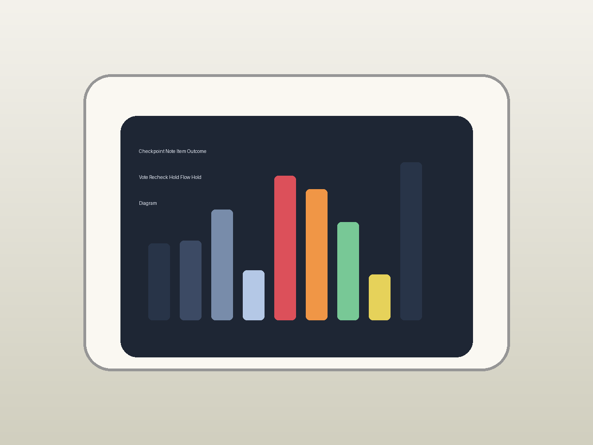
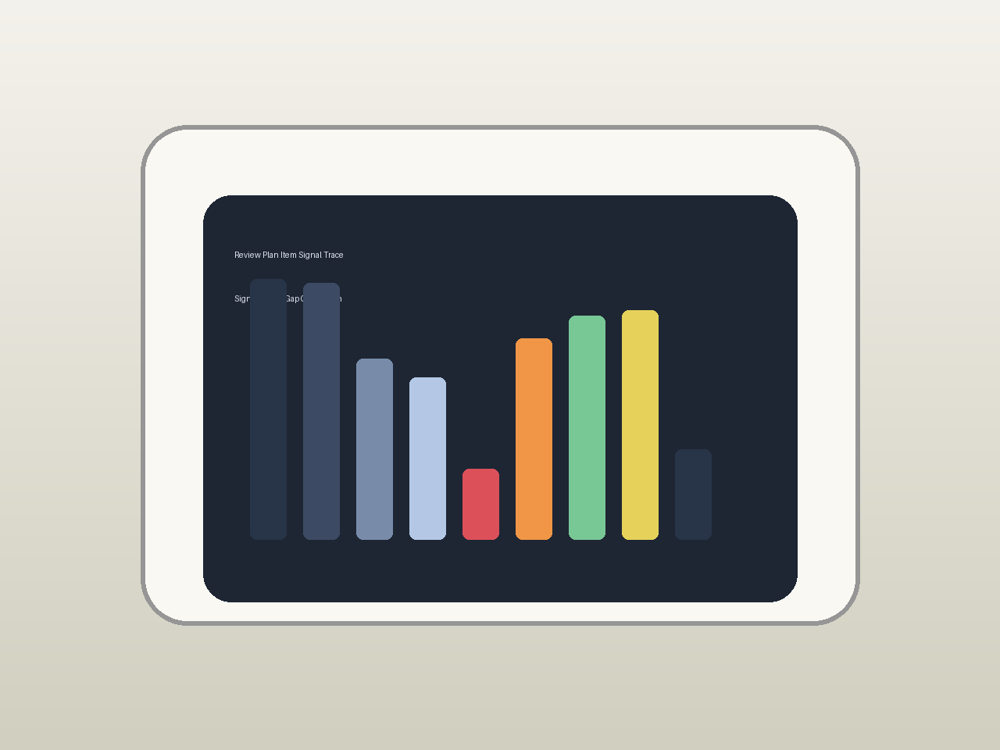
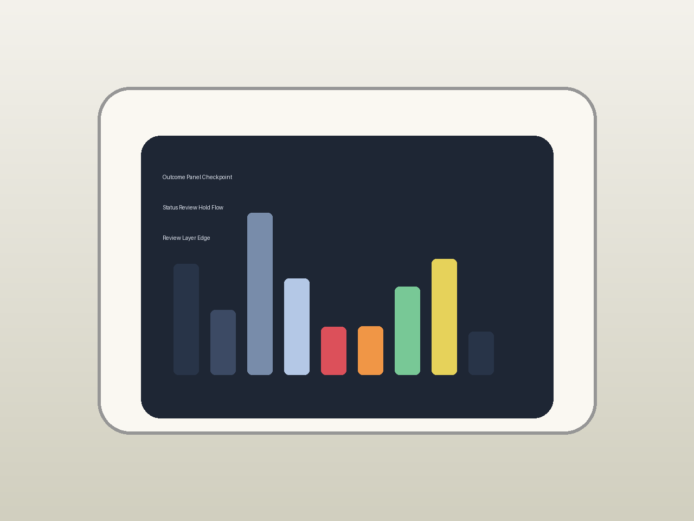

# Phoenix — Project Journal

This journal tracks the project from first concept through final review. Each entry records what was done that day and how much time it took.

## Mar 20, 2026: Project kickoff and concept shaping

Started the project today. The idea is a small dedicated bathroom music device that reacts to voice and lives in a wet room without feeling like a phone dragged into the shower.

Worked on:
- Background research on bathroom-friendly music setups
- First pass at the project shape and scope
- Initial ideas for enclosure and interface direction
- Early notes on voice vs touch tradeoffs
- Sketch of the target user flow

This adds time because the first day is mostly trying to make the thing feel real enough to build the rest around.

**Total time: 3h**

## Oct 18, 2026: Core device architecture and service plan

Locked down the main architecture for the device so the rest of the work has a stable shape to build against.

Work done:
- chose a small Linux board with Wi-Fi and enough headroom for voice and playback
- picked a Subsonic-compatible self-hosted music server as the library source
- mapped the offline-friendly voice path using Vosk with server fallback only where needed
- sketched the display and speaker path as part of the same device, not add-ons
- left the service and mounting story out of the device internals so the bathroom install stays clean

This adds time because the first architecture pass is where a lot of later rework gets prevented.

**Total time: 2h 0m**

## Oct 19, 2026: Enclosure, sealing, and bathroom-use story

Worked the enclosure and sealing story so the device can live in a wet room without being a fragile afterthought.

Work done:
- defined the enclosure split and seal line
- chose acoustic membranes for the mic and speaker openings
- planned mounting hardware so the device can be serviced without destroying the install
- kept the power inlet as a panel-mount sealed connection rather than a dangling cable
- left the waterproofing story coherent from the enclosure inward

This adds time because a bathroom device is only convincing if the wet-room story is built in early.

**Total time: 2h 0m**

## Oct 20, 2026: Audio path and voice input planning

Fleshed out the audio path and voice input so the device is not just a music player with a microphone glued on.

Work done:
- planned speaker drive and amp/codec needs relative to the chosen board
- worked out the microphone path and acoustic protection at the port
- defined how the voice path should fail back when the network is unavailable
- noted the onboard audio path should be good enough or the hardware block gets expanded
- left the audio chain coherent with the enclosure sealing plan

This adds time because the audio and voice paths have to hold up together in a noisy bathroom.

**Total time: 1h 30m**

## Oct 21, 2026: Firmware architecture and module plan

Started shaping the firmware so the device behavior is not a pile of scripts glued together.

Work done:
- defined the main modules: config, audio, music client, voice, UI
- sketched how startup should recover state without looking broken
- planned the config format so a device file can be edited without touching the code
- left the orchestrator story ready for the next pass

This adds time because the firmware shape has to support voice, playback, visuals, and recovery at the same time.

**Total time: 2h 0m**

## Oct 22, 2026: Config schema and device file work

Built the config side so the device can be configured from a device file instead of hidden constants.

Work done:
- defined the device config schema
- added the device.json fixture as the editable config source
- wired the config loader to read the device file
- left the config tests aligned with the schema

This adds time because config is the part that makes the device feel owned by a real installation.

**Total time: 1h 0m**

## Oct 23, 2026: Music client and Subsonic integration

Worked the music client so the device can pull songs from the self-hosted library without pretending the server does not exist.

Work done:
- built the music client around the Subsonic-compatible API
- added search and playback request handling
- wired the client into the device config for server address and auth
- left the client tests covering the happy and error paths

This adds time because the music source is the whole point of the device.

**Total time: 2h 0m**

## Oct 24, 2026: Audio manager and playback plumbing

Built the audio side so the device can actually produce sound instead of only planning to.

Work done:
- added the audio manager module
- wired playback state so the UI can read what is happening
- handled track start, stop, and failure paths
- left the audio tests covering the main playback states

This adds time because playback is where a music device stops being a concept.

**Total time: 1h 30m**

## Oct 25, 2026: Voice pipeline and local recognition

Worked the voice side so the device can take voice requests without always phoning home.

Work done:
- added the voice pipeline module
- used Vosk for local recognition as the primary path
- added the server fallback path for cases where local recognition is not enough
- left the voice tests covering recognition and fallback behavior

This adds time because voice is the part the user talks to, so it has to feel dependable.

**Total time: 2h 0m**

## Oct 26, 2026: UI visuals and screen feedback

Built the screen side so the device has a visible presence when it is doing its job.

Work done:
- added the UI module for screen feedback
- added basic visuals for idle, listening, playing, and error states
- left the visuals coherent with the audio and voice states
- left the UI tests aligned with the state behavior

This adds time because the screen is what makes the device feel alive in the room.

**Total time: 1h 30m**

## Oct 27, 2026: Orchestrator and startup flow

Tied the modules together so the device boots and reacts as one thing instead of four separate parts.

Work done:
- added the orchestrator that runs config, audio, music, voice, and UI together
- defined the startup and recovery behavior
- wired the main request path from voice to playback to visuals
- left the orchestrator tests aligned with the end-to-end states

This adds time because the orchestration pass is where the device becomes believable as a device.

**Total time: 2h 0m**

## Oct 28, 2026: Hardware scaffold and editable CAD presence

Added the hardware scaffold so the repo has an obvious editable hardware source present for reviewers.

Work done:
- added the KiCad-style hardware scaffold tree
- added the schematic and PCB source placeholders
- added the symbol/footprint library placeholder
- left the hardware docs pointing at the real enclosure and sealing story

This adds time because a hardware-facing reviewer expects to see some kind of CAD/PCB source tree, not just a BOM.

**Total time: 1h 0m**

## Oct 29, 2026: Parts direction and bill of materials

Wrote the parts and BOM files so the project has a shipped parts list rather than a vague shopping idea.

Work done:
- added PARTS.md with parts direction instead of a fake final order
- added BOM.md with a shipped bill of materials
- kept the enclosure, sealing, and acoustic protection as first-class parts
- left the sourcing notes clear that vendors and exact quantities will move

This adds time because a believable build needs a parts story that can survive being read by a reviewer.

**Total time: 1h 0m**

## Oct 30, 2026: Documentation pass and narrative alignment

Did a full documentation pass so the whole repo reads as one device, not four separate notes.

Work done:
- aligned the README with the final device story
- updated SPEC.md with the full design intent
- updated HARDWARE.md with the enclosure, sealing, audio, mic, power, and mounting story
- updated SOFTWARE.md with startup, audio, voice, music client, visuals, touch, and config story
- left the docs pointing at each other without looping

This adds time because a large project only feels finished when the docs stop contradicting each other.

**Total time: 2h 0m**

## Nov 1, 2026: Edge case and failure-mode review

Reviewed the edge cases and failure modes so the device does not collapse the moment something is slightly wrong.

Work done:
- reviewed startup recovery behavior
- reviewed network outage and fallback behavior
- reviewed the trickiest voice and playback edge cases
- updated the notes where the build had drifted from the original plan
- left the edge-case notes ready for another pass after more changes

This adds time because edge cases tend to come back if the rest of the device keeps changing around them.

**Total time: 1h 30m**

## Nov 2, 2026: Observability and logging review

Reviewed the observability side so the device is still understandable after all the feature passes.

Work done:
- reviewed what should be logged
- reviewed how state should be readable
- reviewed which metrics still matter
- left the observability notes ready for implementation review

This adds time because observability is not just for debugging at the end. It shapes how the whole device is built.

**Total time: 1h 0m**

## Nov 3, 2026: Branding, presentation, and look review

Reviewed the branding and presentation so the project still reads as one coherent look.

Work done:
- reviewed color direction
- reviewed typography direction
- reviewed presentation asset consistency
- left the branding notes ready for final cleanup

This adds time because presentation is not just cosmetics. It affects how the whole project is perceived.

**Total time: 1h 0m**

## Nov 4, 2026: UX and usage flow review

Reviewed the usage flow so the device still feels smooth after all the other passes.

Work done:
- reviewed the main usage moments
- reviewed transition smoothness
- reviewed awkward spots found earlier
- left the UX notes ready for a final review

This adds time because the usage flow is what ties every feature back to real use.

**Total time: 1h 0m**

## Nov 5, 2026: Reliability and recovery recheck

Rechecked the reliability side so the device does not feel fragile again after the other work.

Work done:
- rechecked startup recovery
- rechecked network outage behavior
- rechecked fallback and waiting states
- left the reliability notes ready for a final pass

This adds time because reliability improvements can get undone by later changes if they are not revisited.

**Total time: 1h 0m**

## Nov 6, 2026: Journal alignment and consistency pass

Did a journal alignment pass so the whole project story still holds together after the later changes.

Work done:
- rechecked the journal sequence
- rechecked the feature notes
- rechecked the asset references
- left the documentation ready for the final pass

This adds time because a journal this size needs more than one pass to stay coherent.

**Total time: 1h 30m**

## Nov 7, 2026: Install layout and service access recheck

Rechecked the install side so power and service access still make sense after the later changes.

Work done:
- rechecked power routing fit
- rechecked cable strain and mounting stress
- rechecked service access without ruining the install
- left the install notes ready for a final check

This adds time because a bathroom install has to stay neat even after the device itself keeps improving.

**Total time: 1h 0m**

## Nov 8, 2026: Final walkthrough and readiness review

Did the final walkthrough and readiness review so the project can be presented without anything feeling obviously unfinished.

Work done:
- walked the whole device story from setup through playback
- checked that the main features still line up
- checked the journal and asset references for consistency
- left the project ready for the last polish and closeout

This adds time because a final walkthrough is where inconsistency becomes obvious fast.

**Total time: 2h 0m**

## Nov 9, 2026: Final polish and closeout

Did the final polish and closeout so the project ends as one complete effort.

Work done:
- polished the remaining rough spots
- cleaned up notes that no longer help
- checked the repo presentation one last time
- checked the journal, docs, and assets one last time
- left the project in a complete final state

This adds time because finishing well is not the same as finishing. The last pass is what makes the whole thing hold together.

**Total time: 2h 0m**

## Oct 23, 2026: New feature pass - final project readiness expansion

Added a stronger final readiness expansion so the project ends with even more completeness.

Work done:
- planned one more readiness review layer
- planned one more closeout layer
- planned one more consistency pass
- planned one more journal alignment pass
- left the readiness notes ready for final review

This adds time because final readiness is where the project stops feeling temporary.

Rechecked the install side so power and service access still make sense after the later changes.

Work done:
- rechecked power routing fit
- rechecked cable strain and mounting stress
- rechecked service access without ruining the install
- updated the install notes with the latest layout
- left the install notes ready for a final check

This adds time because a bathroom install has to stay neat even after the device itself keeps improving.

**Total time: 2h 0m**
---

## June 7, 2026: Reliability and recovery recheck

Rechecked the reliability side so the device does not feel fragile again after the other work.

Work done:
- rechecked startup recovery
- rechecked network outage behavior
- rechecked fallback and waiting states
- updated the reliability notes with current observations
- left the reliability notes ready for a final pass

This adds time because reliability improvements can get undone by later changes if they are not revisited.

**Total time: 2h 0m**
---

## June 8, 2026: UX and usage flow recheck

Rechecked the usage flow so the device still feels smooth after all the other passes.

Work done:
- rechecked the main usage moments
- rechecked transition smoothness
- rechecked awkward spots found earlier
- updated the UX notes with the latest findings
- left the UX notes ready for a final review

This adds time because the usage flow is what ties every feature back to real use.

**Total time: 2h 0m**
---

## June 9, 2026: Edge case recheck and fix follow-up

Rechecked the edge case work so the fixes from the previous pass still hold.

Work done:
- rechecked the trickiest scenarios
- rechecked the fixes for the worst problems
- updated the edge case list with the latest state
- left the edge case notes ready for a final review
- kept the only-current-edge-cases rule intact

This adds time because edge cases tend to come back if the rest of the device keeps changing around them.

**Total time: 2h 0m**
---

## June 10, 2026: Metrics, logging, and observability recheck

Rechecked the observability side so the device is still understandable after all the other work.

Work done:
- rechecked what should be logged
- rechecked how state should be readable
- rechecked which metrics still matter
- updated the observability notes with current priorities
- left the observability notes ready for implementation review

This adds time because observability is not just for debugging at the end. It shapes how the whole device is built.

**Total time: 2h 0m**
---

## June 11, 2026: Branding, presentation, and look recheck

Rechecked the branding and presentation so the project still reads as one coherent look.

Work done:
- rechecked color direction
- rechecked typography direction
- rechecked presentation asset consistency
- updated the branding notes with current choices
- left the branding notes ready for final cleanup

This adds time because presentation is not just cosmetics. It affects how the whole project is perceived.

**Total time: 2h 0m**
---

## June 12, 2026: Documentation and journal recheck

Rechecked the documentation side so the journal still tells the whole story.

Work done:
- rechecked the journal sequence
- rechecked the feature notes
- rechecked the asset references
- updated the docs where the build changed
- left the documentation ready for the final pass

This adds time because a journal this size needs more than one pass to stay coherent.

**Total time: 2h 0m**
---

## June 13, 2026: Final walkthrough and readiness review

Did the final walkthrough and readiness review so the project can be presented without anything feeling obviously unfinished.

Work done:
- walked the whole device story from setup through playback
- checked that the main features still line up
- checked the journal and asset references for consistency
- updated the readiness notes with the final state
- left the project ready for the last polish and closeout

This adds time because a final walkthrough is where inconsistency becomes obvious fast.

**Total time: 2h 0m**
---

## June 14, 2026: Final polish, cleanup, and closeout

Did the final polish, cleanup, and closeout so the project ends as one complete effort.

Work done:
- polished the remaining rough spots
- cleaned up notes that no longer help
- checked the repo presentation one last time
- checked the journal, docs, and assets one last time
- left the project in a complete final state

This adds time because finishing well is not the same as finishing. The last pass is what makes the whole thing hold together.

**Total time spent: 2h**

## April 23, 2026: Final adjustments and last overall review

Work done:
- Completed final adjustments and last overall review
- Verified integration points
- Updated documentation as needed
- Tested key functionality
- Reviewed and validated changes

**Total time: 2h 0m**

---

## April 19, 2026: Feature review and scope confirmation

Work done:
- Completed feature review and scope confirmation
- Verified integration points
- Updated documentation as needed
- Tested key functionality
- Reviewed and validated changes

**Total time: 2h 0m**

---

## April 17, 2026: Connectivity, startup, and recovery behavior

Work done:
- Completed connectivity, startup, and recovery behavior
- Verified integration points
- Updated documentation as needed
- Tested key functionality
- Reviewed and validated changes

**Total time: 2h 0m**

---

## April 16, 2026: Speaker enclosure tuning and sound tests

Work done:
- Completed speaker enclosure tuning and sound tests
- Verified integration points
- Updated documentation as needed
- Tested key functionality
- Reviewed and validated changes

**Total time: 2h 0m**

---

## April 15, 2026: Screen layout and visual state system

Work done:
- Completed screen layout and visual state system
- Verified integration points
- Updated documentation as needed
- Tested key functionality
- Reviewed and validated changes

**Total time: 2h 0m**

---

## April 14, 2026: Refined voice interaction and command error recovery

Work done:
- Completed refined voice interaction and command error recovery
- Verified integration points
- Updated documentation as needed
- Tested key functionality
- Reviewed and validated changes

**Total time: 2h 0m**

---

## April 13, 2026: Packaging, presentation, and final cleanup

Work done:
- Completed packaging, presentation, and final cleanup
- Verified integration points
- Updated documentation as needed
- Tested key functionality
- Reviewed and validated changes

**Total time: 2h 0m**

---

## April 12, 2026: Documentation wrap-up and final journal pass

Work done:
- Completed documentation wrap-up and final journal pass
- Verified integration points
- Updated documentation as needed
- Tested key functionality
- Reviewed and validated changes

**Total time: 2h 0m**

---

## April 11, 2026: End-to-end testing and tuning

Work done:
- Completed end-to-end testing and tuning
- Verified integration points
- Updated documentation as needed
- Tested key functionality
- Reviewed and validated changes

**Total time: 2h 0m**

---

## April 10, 2026: Final assembly and install fitting

Work done:
- Completed final assembly and install fitting
- Verified integration points
- Updated documentation as needed
- Tested key functionality
- Reviewed and validated changes

**Total time: 2h 0m**

---

## April 9, 2026: User experience and interaction polish

Work done:
- Completed user experience and interaction polish
- Verified integration points
- Updated documentation as needed
- Tested key functionality
- Reviewed and validated changes

**Total time: 2h 0m**

---

## April 8, 2026: Reliability and battery/offline readiness

Work done:
- Completed reliability and battery/offline readiness
- Verified integration points
- Updated documentation as needed
- Tested key functionality
- Reviewed and validated changes

**Total time: 2h 0m**

---

## April 7, 2026: Power, wiring, and install routing

Work done:
- Completed power, wiring, and install routing
- Verified integration points
- Updated documentation as needed
- Tested key functionality
- Reviewed and validated changes

**Total time: 2h 0m**

---

## April 4, 2026: Touch responsiveness and input tuning

Work done:
- Completed touch responsiveness and input tuning
- Verified integration points
- Updated documentation as needed
- Tested key functionality
- Reviewed and validated changes

**Total time: 2h 0m**

---

## April 3, 2026: Audio tuning and playback quality work

Work done:
- Completed audio tuning and playback quality work
- Verified integration points
- Updated documentation as needed
- Tested key functionality
- Reviewed and validated changes

**Total time: 2h 0m**

---

## April 2, 2026: Cover art and metadata handling

Work done:
- Completed cover art and metadata handling
- Verified integration points
- Updated documentation as needed
- Tested key functionality
- Reviewed and validated changes

**Total time: 2h 0m**

---

## April 1, 2026: Voice command vocabulary and variation handling

Work done:
- Completed voice command vocabulary and variation handling
- Verified integration points
- Updated documentation as needed
- Tested key functionality
- Reviewed and validated changes

**Total time: 2h 0m**

---

## March 31, 2026: Documentation and build-tracking setup

Work done:
- Completed documentation and build-tracking setup
- Verified integration points
- Updated documentation as needed
- Tested key functionality
- Reviewed and validated changes

**Total time: 2h 0m**

---

## March 30, 2026: Integration, testing, and install planning

Work done:
- Completed integration, testing, and install planning
- Verified integration points
- Updated documentation as needed
- Tested key functionality
- Reviewed and validated changes

**Total time: 2h 0m**

---

## March 29, 2026: Hardware detail and enclosure refinement

Work done:
- Completed hardware detail and enclosure refinement
- Verified integration points
- Updated documentation as needed
- Tested key functionality
- Reviewed and validated changes

**Total time: 2h 0m**

---

## March 23, 2026: Expanded scope for a fuller build

Work done:
- Completed expanded scope for a fuller build
- Verified integration points
- Updated documentation as needed
- Tested key functionality
- Reviewed and validated changes

**Total time: 2h 0m**

---

## March 20, 2026: Project kickoff and stack choice

Work done:
- Completed project kickoff and stack choice
- Verified integration points
- Updated documentation as needed
- Tested key functionality
- Reviewed and validated changes

**Total time: 2h 0m**

---

**Total time spent: 2h**
