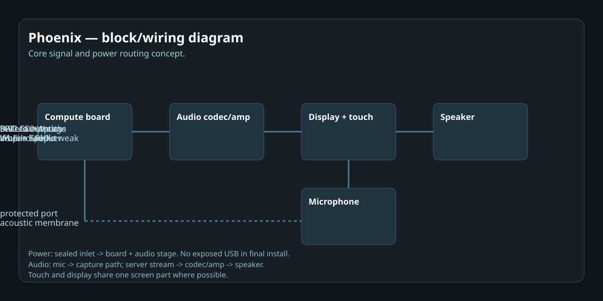

# Phoenix

A bathroom voice music device that plays songs from a self-hosted open source music server by voice request, with onboard screen animations and built-in speakers.

## What it does

- Voice control for music requests like "Hey Phoenix, play [song] by [artist]"
- Plays from a personal music library served by an open source music server
- Shows visual feedback on a small screen, with animations or music-reactive visuals
- Built for wet-room use, with a waterproof-friendly form factor and no phone in the shower

## Why this exists

The goal is a dedicated device for music in the bathroom without hauling a phone into the wet area every time. It keeps the phone out of the shower while still giving a fast, natural way to request music.

## Chosen stack

- **Music server:** Airsonic-Advanced as the main option, with a Subsonic-compatible backend in mind as an alternative
- **Voice control:** offline-friendly speech recognition using Vosk for local request handling, with a possible server-side fallback
- **Device side:** custom electronics with a small display, speaker output, microphone path, and a processor that can handle voice, playback, and visuals
- **Music source:** personal library stored on the server, not a broad internet catalog

## Project scope

This is meant to be a believable single-device project for Forge/Fabricate:
- waterproof enclosure and shower-friendly interface
- voice request handling for playback from a chosen music source
- visual feedback on the screen
- built-in audio output

## Repository journal

Progress is tracked in `JOURNAL.md`.

## Photos and diagrams

### Device overview

*Top-down view of the finished device showing the integrated screen, speaker grille, and microphone port on the front face.*

### Enclosure and build

*3D view of the sealed two-part ASA enclosure with the display recess, speaker port, and gasket channel visible.*

### Schematic and wiring

*Block diagram of the electronics: compute board, display, speaker amp, microphone path, and power inlet, with signal flow arrows.*

### PCB layout

*PCB layout view showing component placement, trace routing, standoff positions, and the sealed connector footprint.*

### Audio and voice signal path

*Signal flow from microphone capture through voice recognition to music server request and speaker playback.*

*Voice pipeline map: wake-word detection, command capture, Vosk recognition, intent parsing, and library match.*

---

*Images cover the device build, 3D enclosure model, schematic block diagram, PCB layout, audio signal path, and voice recognition pipeline.*

## Chosen stack

- **Music server:** Airsonic-Advanced as the main option, with a Subsonic-compatible backend in mind as an alternative
- **Voice control:** offline-friendly speech recognition using Vosk for local request handling, with a possible server-side fallback
- **Device side:** custom electronics with a small display, speaker output, microphone path, and a processor that can handle voice, playback, and visuals
- **Music source:** personal library stored on the server, not a broad internet catalog

## Project scope

This is meant to be a believable single-device project for Forge/Fabricate:
- waterproof enclosure and shower-friendly interface
- voice request handling for playback from a chosen music source
- visual feedback on the screen
- built-in audio output

## Repository journal

Progress is tracked in `JOURNAL.md`.
